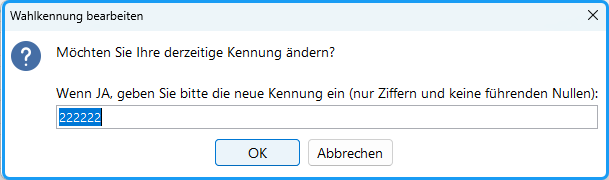

Wählen Sie im Menü `Funktionen` den Befehl: `Wahlkennung bearbeiten`

Die Wahlkennung ist eine bis zu sechsstellige Zahl, die den Wahlvorgang zu identifizieren hilft. Beim Importieren von Stimmen, die scannergestützt oder online ermittelt wurden, wird kontrolliert, ob sie dem richtigen Wahlvorgang zugeordnet werden sollen. Die Wahlkennung wird automatisch erzeugt, wenn ein Wahlbereich mit der Kandidat:inneneingabe fertig ist.

*Abb. : Wahlkennung bearbeiten*

Bei älteren Wahlvorgängen kann die Wahlkennung fehlen; sie kann dann mit dieser Funktion bearbeitet werden.
