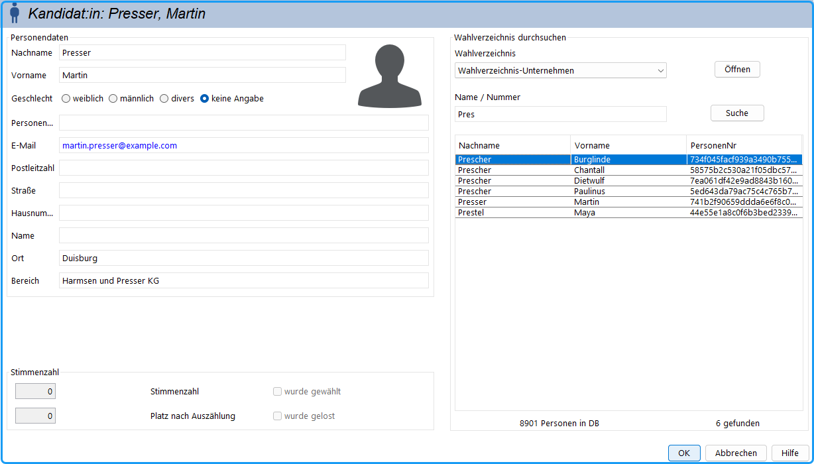

## Menü: Wahlverzeichnis / Person suchen/bearbeiten: {#menue-wahlverzeichnis-person-suchen-bearbeiten}

Dafür muss mindestens ein Wahlverzeichnis geöffnet sein. Es öffnet sich ein Dialogfenster, das dem Kandidat:inneneingabe-Dialog  ähnelt.

- Wählen Sie rechts ein Wahlverzeichnis aus.

*Abb. : Bearbeiten der Personendaten*

- Öffnen Sie mit „Öffnen“ weitere Wahlverzeichnisse.
- Geben Sie den Namensanfang oder die (Personen-)Nummer (Matr.-Nr.) an und betätigen Sie „Suche“.
- Wählen Sie aus der Liste eine Person aus.
- Sie können die Personendaten ändern und mit „Speichern“ die Daten in das Wahlverzeichnis schreiben.
- In dem Ankreuzfeld „Briefwahl beantragt“ wird angegeben, dass die Person Briefwahl beantragt hat.
- Mit „Neu“ kann eine neue Person in das Wahlverzeichnis eingetragen werden. Geben Sie dazu die Personendaten ein und betätigen Sie „Speichern“.
- Mit „Löschen“ kann die aktuell angezeigte Person aus dem Wahlverzeichnis gelöscht werden.
- Nacheinander können bei geöffnetem Dialog beliebig viele Personendaten bearbeitet werden.
