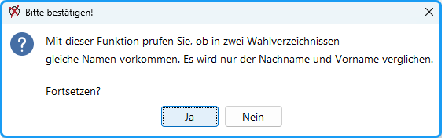
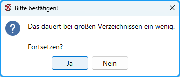

Im Menü unter `Wahlverzeichnis` und `abgleichen` können Sie mehrere Wahlverzeichnisse miteinander vergleichen.

Es kann vorkommen, dass Personen in mehreren Wähler:innengruppen wahlberechtigt sind, z.B. Mitarbeiter:innen, die nebenbei noch studieren; sie müssen sich dann normalerweise für einen Bereich entscheiden. Um festzustellen, ob Personen in mehreren Wahlverzeichnissen aufgeführt sind, dient die Funktion Wahlverzeichnis /Abgleichen.

*Abb. : Wahlverzeichnisse abgleichen*

Falls, die Größe der Wahlverzeichnisse hoch ist, wird die Dauer des Vorgangs länger sein.

*Abb. : Wahlverzeichnisse abgleichen*

## Wahlverzeichnis für den Wahlraum ausgeben {#wahlverzeichnis-fuer-den-wahlraum-ausgeben}

Mit dem Menübefehl: `Wahlverzeichnis / Exportieren als Exceltabelle` wird ein Wahlverzeichnis als Excel-Datei zum Ausdrucken für den Gebrauch in den Wahllokalen erzeugt.

Mit dem Menübefehl: `Wahlverzeichnis / Exportieren nach Wahlraum` wird ein Wahlverzeichnis zur direkten Übergabe an die uniWAHL Wahlraum-Software erzeugt.

Bei Personen, die die Briefwahl beantragt haben, wird dieses vermerkt; die Zeile ist dann außerdem grau hinterlegt. Es werden alle Felder in die Excel-Datei geschrieben; wegen der Übersichtlichkeit sollten Sie vor dem Ausdrucken die nicht benötigten Felder (Spalten) löschen.
