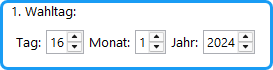
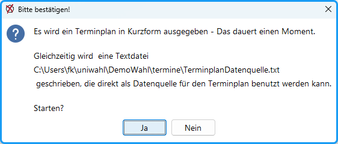
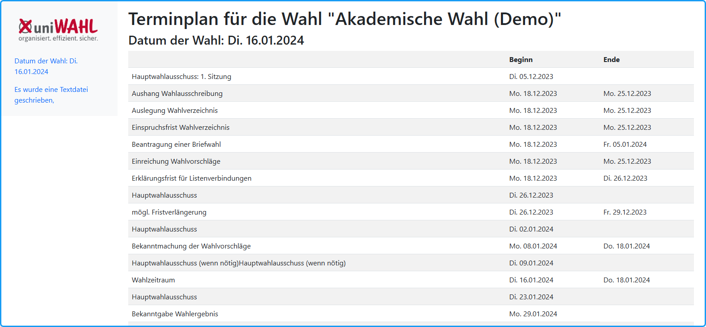
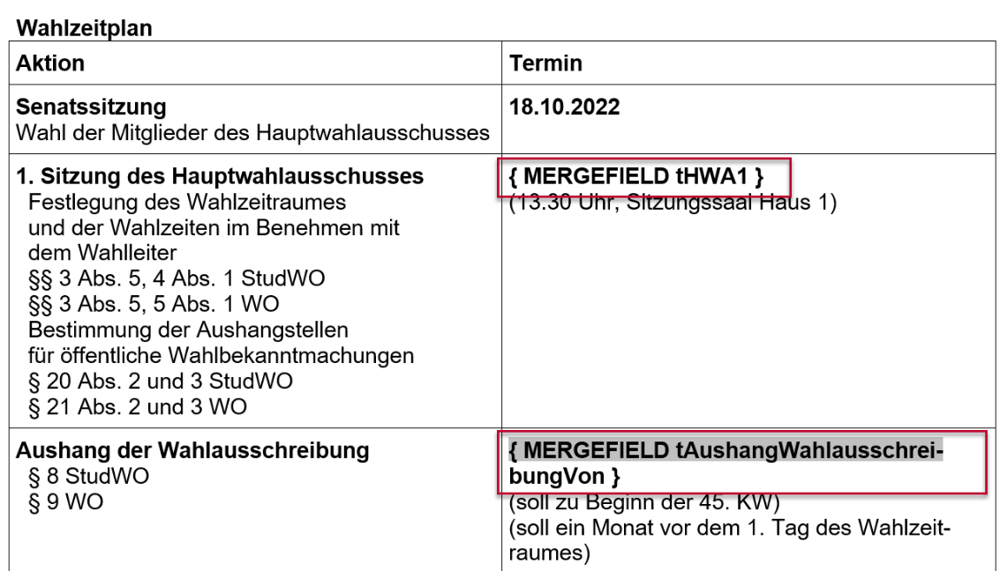
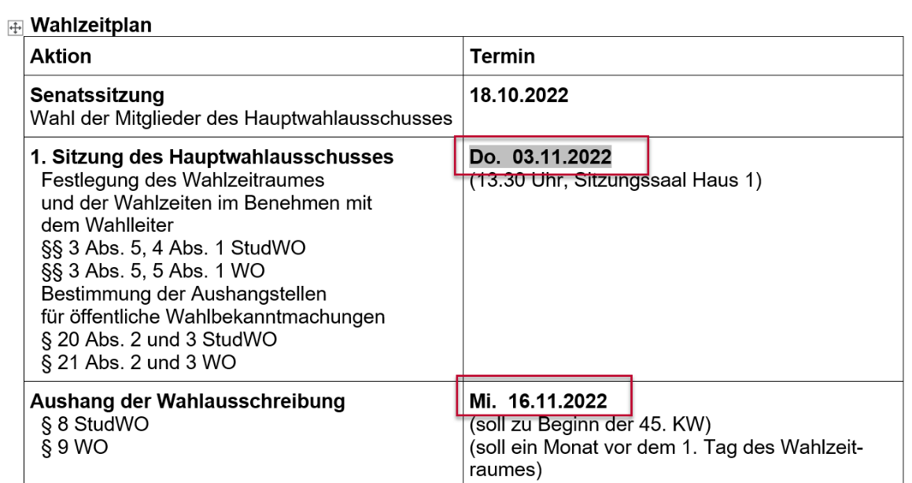

## Wahltag: {#wahltag}

Zuerst wird der erste Tag des Wahlzeitraums festgelegt; auf diesen Tag beziehen sich die anderen Angaben. Im Wahl-Dialog werden diese Eingaben vorgenommen (→ [Wahldialog](../4_vorbereitung/4-3_wahl_konfigurieren.md)):

*Abb. : Ersten Wahltag festlegen*

## Wahlordnung: {#wahlordnung}

Das Register „Wahlordnung“ enthält eine Karte : `Terminplan` ( → [Wahlordnung](../4_vorbereitung/4-2_wahlordnung.md#terminplan)). Hier werden einmalig aus der Wahlordnung und ggf. anderen Bestimmungen die Termine für die einzelnen Aktionen eingetragen. Sie werden immer relativ zu dem 1. Wahltag festgelegt. Diese Eintragungen werden nur einmal vorgenommen, da sich diese – wie auch die anderen Wahlordnungsbestimmungen – normalerweise nicht ändern.

## Texte festlegen {#texte-festlegen}

Die in diesem Dialog und auch in der Kurzfassung des Terminplans benutzten Bezeichnungen können im Register `Texte bearbeiten` festgelegt werden ( → [Texte Terminplan](../7_wahldokumente/7-3_textbausteine.md#texte-terminplan) )

## Ausgabe des Terminplans {#ausgabe-des-terminplans}

Im Menü `Ausgabe` wird der Aufruf `Terminplan` gestartet. Es öffnet sich ein Dokument mit einer Kurzform des Terminplans (s. Abb.).

*Abb. : Terminplan-Dialog*

*Abb. : Terminplan in Kurzform. Hier werden die im Textdialog festgelegten Textbausteine benutzt (Ausschnitt).*

## Erstellung eines Terminplans in ausführlicher Form. {#erstellung-eines-terminplans-in-ausfuehrlicher-form}

Zusätzlich zu der Kurzform des Terminplans wird eine Datei erstellt, die als Datenquelle für ein Seriendruck-Dokument benutzt werden kann.

Der Terminplan in ausführlicher Form kann aus dem an Ihrer Einrichtung üblichen Dokument für die Zeitplanung entwickelt werden. In dieses Dokument werden die Seriendruck-Felder, die in die Datei „TerminplanDatenquelle.txt“ geschrieben wurden, benutzt.

Am Beispiel von „Word für Windows“ soll das erläutert werden (je nach Version können die Bezeichnungen und auch das Verfahren unterschiedlich sein).

- Ausgegangen wird von einem Textdokument in Word.
- Sollte nur eine Excel-Datei vorliegen, exportieren Sie mit `Speichern unter...` als „Text (Tabs getrennt) *.txt“ , öffnen Sie diese mit Word und speichern Sie z.B. als „Terminplan.doc“. In Word markieren Sie den Bereich der Tabelle und wandeln den Text in eine Tabelle um: Menü `Tabelle`: `umwandeln` / `Text in Tabelle`. Verschönern Sie die Tabelle, indem Sie ggf. Zellen zusammenfassen: Menü *`Tabelle`: `Zellen verbinden`*.
- Machen Sie aus Ihrem Dokument ein Seriendruck-Dokument: Menü: Extras `Seriendruck` öffnet den Seriendruck-Manager: `Hauptdokument`, `Erstellen`, `Serienbriefe` und wählen Sie als Hauptdokument: `Aktives Fenster`.
- `Daten importieren`: Mit `Datenquelle öffnen` wählen Sie den Pfad zu der Datei „TerminplanDatenquelle.txt“ (Dateityp: Textdateien (*.txt)).
- Anschließend werden Sie aufgefordert, dem Hauptdokument `Seriendruckfelder` hinzuzufügen. Betätigen Sie: `Hauptdokument bearbeiten`. Word zeigt jetzt zusätzlich die Werkzeugleiste für den Seriendruck an.
- Tauschen Sie in Ihrem alten Terminplan die fest eingegebenen Daten durch die entsprechenden Seriendruckfelder aus(s. Abb.). Dazu betätigen Sie jeweils: `Seriendruckfeld einfügen`. Mit der Taste „ABC“ werden die Daten aus der Datenquelle direkt angezeigt (s. Abb.).
- Das Ergebnis könnte wie folgt aussehen. Sie können diese Datei noch bearbeiten; so wurde in dem gezeigten Beispiel der Termin der Senatssitzung manuell eingetragen, denn dieser ist natürlich nicht durch die Wahlordnung bestimmt.
- Drucken Sie den Terminplan mit `Seriendruck an Drucker` aus.

*Abb. : Ausführlicher Terminplan mit Seriendruckfeldern als Platzhalter*

*Abb. : Ausführlicher Terminplan mit eingefügten Daten (in MS-Word)*
