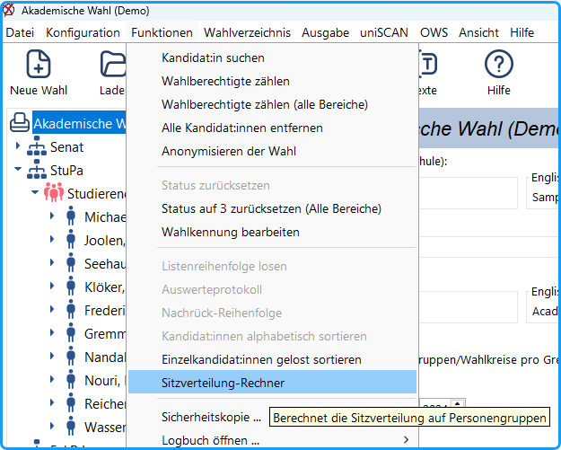
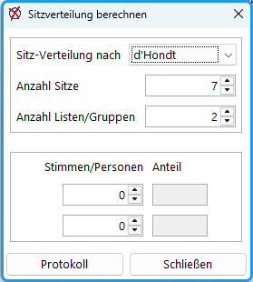
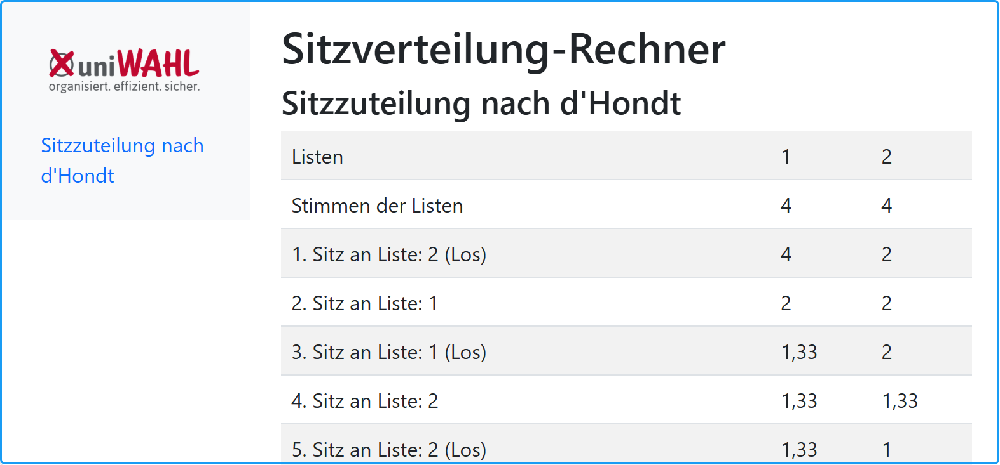

Der Sitzverteilungsrechner kann für verschiedene Anwendungen benutzt werden, wenn Sitze auf verschiedene Gruppen bzw. Listen verteilt werden sollen. Bei Personalratswahlen werden z.B. die Sitze zwischen Beamten und Angestellten aufgeteilt, und in diesen Gruppen außerdem auf Frauen und Männer.

*Abb. : Funktionen – Sitzverteilung-Rechner*

## Sitzverteilung berechnen {#sitzverteilung-berechnen}

Im Menü Funktionen (→Abb.) im Untermenü „Sitzverteilung-Rechner“ gibt es folgende Einträge:

*Abb. : Sitzverteilung berechnen*

**Sitzverteilung nach:** Das in der Wahlordnung definierte Sitzzuteilungsverfahren wird vorbesetzt. Dieses wird in der Überschriftenzeile angezeigt (→ Abb.) und kann geändert werden.

- **Anzahl Sitze**: Hier werden die zu verteilenden Sitze eingegeben.
- **Anzahl Listen/Gruppen**: Hier wird angegeben, auf wie viele Gruppen/Listen verteilt werden soll. Im Standard sind dies zwei, können aber auch mehr sein. Dann wird das untere Panel um entsprechende Zeilen erweitert.
- **Stimmen/Personen**: Hier werden die Stimmen pro Liste oder Personen pro Gruppe eingegeben.
- **Anteil**: Die Stimmanteile werden automatisch berechnet und in die jeweilige Gruppe/Liste geschrieben.

Die Schaltfläche *Protokoll* zeigt den Verlauf der Sitzzuteilung im Browser.

*Abb. : Beispiel-Sitzverteilung nach d'Hondt*
