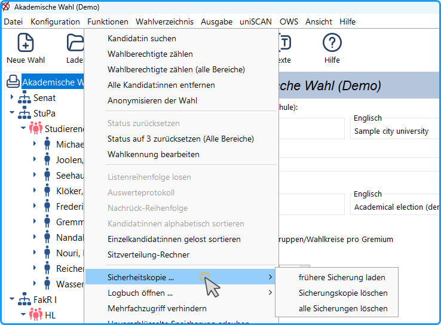

Das Programm erstellt in regelmäßigen Abständen automatisch Sicherungskopien, die in den Ordner *whl/temp* im Arbeitsverzeichnis kopiert werden. So hat man die Möglichkeit, ohne Mühe einen früheren Zustand wieder herzustellen.

*Abb. : Funktionen - Sicherheitskopie*

## Erstellung der Sicherungskopien {#erstellung-der-sicherungskopien}

Wenn der Wahlvorgang geändert wurde, wird

- alle 5 Minuten eine Kopie mit dem Namen *BACKUP.whl* gemacht, die anschließend überschrieben wird, und
- alle 30 Minuten eine permanente Kopie erstellt, die den Namen des Wahlvorgangs und einen Zeitstempel bekommt:
*Wahlvorgang_yyyymmddhhmm.whl*

## Laden und Löschen von Sicherungskopien {#laden-und-loeschen-von-sicherungskopien}

Im Menü `Funktionen` (→ Abb.) gibt es ein Untermenü: `Sicherungskopie` mit folgenden Menübefehlen:

**frühere Sicherung laden:** Es öffnet sich ein Auswahldialog, mit dem aus dem Ordner *temp* eine Sicherungskopie ausgewählt werden kann. Man sollte diese dann im Ordner *whl* unter einem passenden Namen speichern.

**Sicherungskopie löschen**: Aus den Dateien in *temp* kann eine ausgewählt werden.

**alle Sicherungen löschen**: Alle Dateien aus *temp* löschen.
