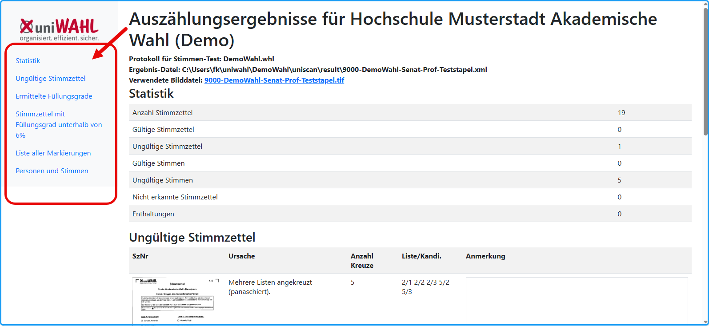
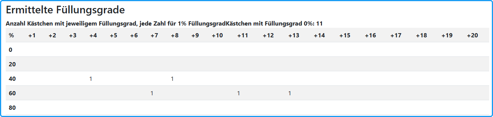
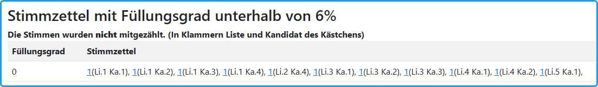

Unter Menü: `uniSCAN/Importierte Stimmen` können Sie das Importprotokoll aufrufen.

In dem Import-Protokoll werden viele Meldungen protokolliert und im Browser angezeigt. Es ist sinnvoll, dieses Protokoll nach dem Importieren der Stimmen sofort auszudrucken und zu dem entsprechenden Stapel zu legen. Hier werden nachträgliche Korrekturen dokumentiert.

*Abb. : Importprotokoll in HTML*

## Fehlermeldungen und Warnungen {#fehlermeldungen-und-warnungen}

- *uniWAHL* meldet, welche Stimmzettel ungültig sind und warum: Zu viele oder null Kreuze, zusätzliche Bemerkungen oder Panaschierverbot missachtet.
- *uniWAHL* meldet Warnungen, wenn der Schwärzungsgrad im Grenzbereich liegt. Die Stimmen werden mitgezählt. Man kann ggf. das Zählergebnis korrigieren.
- *„Stimmzettel-Nr.“* ist als Hyperlink auf die Bilddatei ausgebildet: Mit *Klick* öffnen Sie die Bilddatei. Die Bilder werden mit der im System festgelegten Anwendung für Tiff-Dateien (z.B. *IrfanView*) geöffnet.
- Sollte ausnahmsweise ein Stimmzettel nicht erkannt werden (z.B. wegen umgeknickter Ecke), wird dieses in dem Protokoll vermerkt. Die Bilddatei dieses Stimmzettels kann durch Anklicken des Links in der Protokolldatei angesehen und die Stimmen in dem entsprechenden Wahlbereich nachgetragen werden.

## Test der Füllungsgrade und Schwellwerte {#test-der-fuellungsgrade-und-schwellwerte}

Das Importprotokoll enthält auch eine Statistik der Füllungsgrade der eingelesenen Kästchen. Dadurch ist es möglich, die Korrektheit der festgelegten Schwellwerte zu überprüfen.

*Abb. : Ermittelte Füllungsgrade im Import-Protokoll*

Füllungsgrade: Der untere Schwellwert lag bei 11 %. Ein Kästchen mit einem Füllungsgrad von 0 % wurde nicht gezählt.

Ein Kästchen mit 40 % Füllungsgrad wurde eindeutig erkannt und gezählt.
Mehrere Kästchen mit Füllungsgraden im Bereich um 60 % wurden ebenfalls eindeutig erkannt und gezählt.

Alle erfassten Werte liegen deutlich über dem unteren Schwellwert. Ein unsicherer Grenzbereich ist in diesem Beispiel nicht erkennbar.

## Füllungsgrad unterhalb des Schwellwertes {#fuellungsgrad-unterhalb-des-schwellwertes}

Durch unachtsames Ankreuzen können Füllungsgrade unterhalb des Schwellwertes entstehen. Im Protokoll werden diese vermerkt und können schnell herausgefiltert und korrigiert werden.

*Abb. : Füllungsgrad unterhalb des Schwellwertes*

## Protokoll aller Stimmzettel {#protokoll-aller-stimmzettel}

Zu jedem importierten Stapel wird eine Datei: .*..Sz-Protokoll.html* erzeugt, die eine Liste aller Markierungen mit mehr als 5% Füllungsgrad enthält; jedes Kästchen ist durch ListenNr / Kandidat:innenNr gekennzeichnet.

## Protokoll der Kandidat:innen-Stimmen {#protokoll-der-kandidat-innen-stimmen}

Eine Liste der Kandidat:innen und den erworbenen Stimmen wird erstellt.

## Nominieren von Kandidat:innen {#nominieren-von-kandidat-innen}

Im Fall von (Nach-)Nominierungen werden die handschriftlich beschriebenen Felder angezeigt und den Stimmzetteln zugeordnet. Die auf die Person fallende Stimmenzahl erscheint in der letzten Spalte.

Diese nominierten Kandidat:innen können direkt in *uniWAHL* eingegeben werden. Öffnen Sie dazu den angegebenen Wahlbereich (Gremium / Gruppe). Wenn die Person noch nicht vorgeschlagen wurde, betätigen Sie die Taste: *„Neuer Kandidat"* . Anschließend geben Sie ihr die ermittelten Stimmen.
