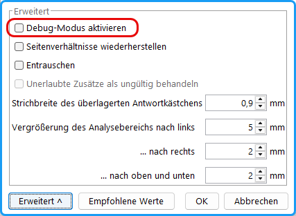

Im Debug-Modus erhalten Sie genauere Informationen über die Analyseergebnisse.

- Unter Menü uniSCAN/ `Einstellungen“/„Erweitert` wählen Sie Debug-Modus.
- Im Ordner *uniscan / debug* werden für jeden Stimmzettel Bilder mit dem Analyseergebnis abgelegt.
- Testen Sie jeweils nur 1 Stimmzettel. Prüfen Sie die Bilder.

*Abb. : Debug-Modus aktivieren*

Wenn alles funktioniert, muss der Debug-Modus nicht abgeschaltet werden, da die Performance nur wenig beeinflusst wird.

Im Debug-Modus wird die Erkennung der einzelnen Elemente angezeigt:

- Gefundene Justierecken werden rot markiert.
- Die im Barcode (1. Zeile) gefundenen Bits und die Paritätsbits werden markiert.
- Der Analysebereich um jedes Kästchen wird angezeigt.
- Ein grüner bzw. roter Punkt zeigt, ob eine Stimme gewertet wurde, ein gelber: Grenzbereich.
- Der gefundene Schwärzungsgrad wird angegeben.
- Bei leeren Kästchen wird die Innenkontur orange dargestellt.
- Unzulässige Zusätze werden zusätzlich angezeigt.

 Abb. : Analyseergebnisse aus dem Debug-Modus
