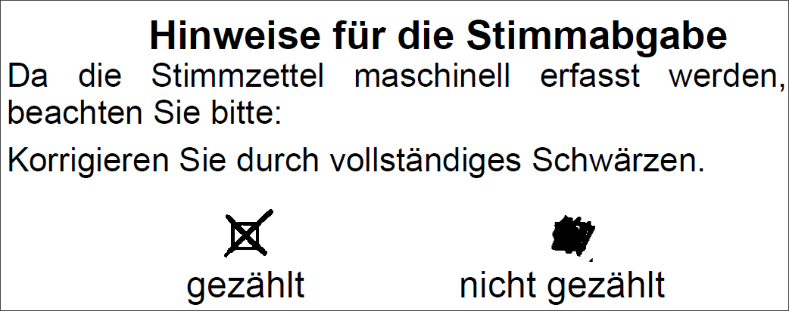
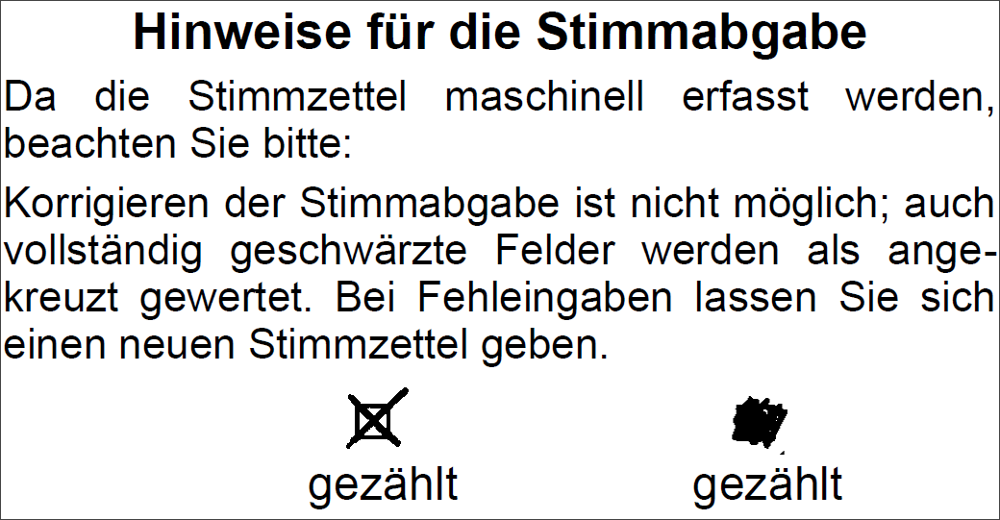

Es ist nicht notwendig, die Stimmzettel vor dem Scannen zu sortieren. Trotzdem kann es sinnvoll sein, diese nach Wahlbereichen zu sortieren, damit man eine bessere Kontrolle z.B. über die Anzahl hat. Dabei werden sie entfaltet und ausgerichtet.

Sie sollten im Wahllokal und in der Stimmkabine Hinweise zum Ankreuzen aufhängen. Dazu kann eines der folgenden Muster (siehe Abb.) benutzt werden.

*Abb. : Aushang in der Wahlkabine, wenn Korrigieren der Stimmabgabe erlaubt ist*

*Abb. : Aushang in der Wahlkabine, wenn Korrigieren der Stimmabgabe *nicht* erlaubt ist*
