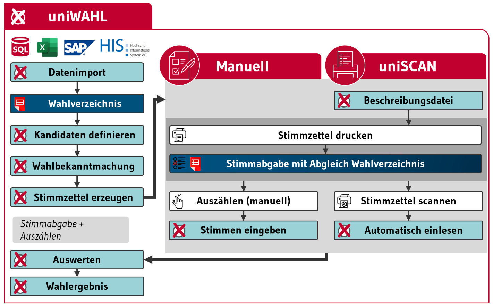

Die Abbildung zeigt links den gewohnten, manuellen Ablauf der Wahl mit ***uniWAHL***.

1. Für das automatische Einlesen der Stimmzettel werden die Stimmzettel in ***uniWAHL*** wie gewohnt erstellt, wobei vorher im Dialog *Layout/Stimmzettel* oder im Menü *Ausgabe/Stimmzettel* die Option: *Stimmzettel zum Scannen* gewählt wird.
1. Die Stimmzettel erhalten einen Barcode zur Identifizierung des Stimmzetteltyps (Wahlbereich) und Eckwinkel für die Positionierung. Außerdem wird eine Stimmzettel-Beschreibungsdatei erzeugt, die Informationen für das Erkennen der markierten Felder enthält.
1. Nach der Stimmabgabe werden die Stimmzettel mit einem Scanner eingelesen, von *uniWAHL* analysiert und die Anzahl Stimmen in *uniWAHL* importiert.

*Abb. : Schematischer Vergleich des uniSCAN-Verfahrens*
