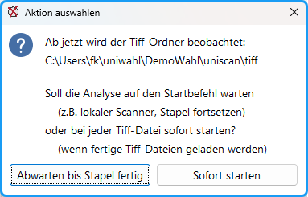

## Arbeitsverzeichnis einstellen (s. Kap. 11.3 ) {#arbeitsverzeichnis-einstellen-s-kap-11-3}

Starten Sie *uniWAHL*. Über den Menübefehl: `Konfiguration/ Arbeitsverzeichnis / Öffnen andere…` stellen Sie das Arbeitsverzeichnis ein. Dabei werden die benötigten Unterverzeichnisse automatisch eingerichtet. Ändern Sie während des Wahlvorgangs das Arbeitsverzeichnis möglichst nicht mehr.

## Stimmzettel erstellen (s. Kap. 11.4 ) {#stimmzettel-erstellen-s-kap-11-4}

Stellen Sie im Ausgabe-Menü oder im Layout-Dialog *„Stimmzettel zum Einscannen“* ein und starten die Ausgabe. Prüfen Sie, ob zu jeder Stimmzettel-ID (auf dem Stimmzettel links unten) eine entsprechende xml-Datei im Verzeichnis `Arbeitsverzeichnis / uniscan / formular` abgelegt wurde. Ändern Sie während eines Wahlvorgangs die *Formular-ID* nicht manuell!

## Scan-Programm einrichten (s. Kap. 11.8 ) {#scan-programm-einrichten-s-kap-11-8}

- Starten Sie Ihr Scan-Programm (z.B. IrfanView).
- Menü `Datei`: TWAIN Quelle wählen: Ihr Scanner
- Menü `Datei / Scannen/Batch-Scannen`
- Einstellungen:
   - Ziel-Dateiname: Beliebig wählbar
   - Ziel-Ordner: Arbeitsverzeichnis / uniscan / tiff
   - TIFF-Multipage eine Datei pro Stapel
- Optionen: Komprimierung: z.B. *„CCITT Fax 4“* (erzeugt die kleinsten Dateien),
- Scanner-Dialog:
   - Schwarz-Weiß-Modus
   - (200 -) 300 dpi
   - Papierformat A4 etc.
   - Simplex (nur Vorderseite scannen)
- `Scannen`

## Leere Stimmzettel testen {#leere-stimmzettel-testen}

- Rechtzeitig vor der Wahl nach dem Drucken testen Sie die Stimmzettel. Stellen Sie einen Stapel mit je einem leeren Stimmzettel her und nennen ihn z.B. „Leer“ oder „Referenz“. Scannen Sie ihn in den „*tiff*“-Ordner.
- Entfernen Sie unter `uniSCAN/Einstellungen` das Häkchen bei `Unerlaubte Zusätze suchen` . Analysieren und testen (nicht importieren oder mit einer Testkopie der whl-Datei arbeiten). Alle Stimmzettel müssen ungültig sein.

## Referenzstimmzettel {#referenzstimmzettel}

Diese werden benötigt, wenn man *Unerlaubte Zusätze* suchen will; auch andere Parameter wie der Analysebereich der Stimmzettel werden bestimmt. Dadurch wird die Sicherheit der Analyse gesteigert.

- Benutzen Sie dieselben Stimmzettel, die auch die Wählenden bekommen.
- Menü: `uniSCAN/„Referenzstimmzettel vorbereiten` : Geben Sie den vorher eingescannten Stapel leerer Stimmzettel an; er wurde nach der Analyse in den „*archive*“-Ordner kopiert.

## Ausgefüllte Stimmzettel testen {#ausgefuellte-stimmzettel-testen}

- Stellen Sie einen Stapel mit Stimmzetteln von allen Typen her und füllen Sie diese aus.
- Scannen Sie die Stimmzettel.
- Scanner-Dialog: Stapel beenden (*IrfanView*: „Abbrechen“)
- `Menü /uniSCAN/ „Analysieren vorhandene Tiff-Dateien`; bitte nur `Testen`, damit keine Stimmen etc. übernommen werden. (oder aus Sicherheitsgründen mit einer Kopie der *whl*-Datei arbeiten.)
- Kontrollieren Sie im Protokoll die analysierten Stimmen und die ungültigen Stimmzettel. Korrigieren Sie ggf. die Schwellwerte.

## Produktion {#produktion}

#### A: Betriebsart Online: Vor-Ort-Scannen {#a-betriebsart-online-vor-ort-scannen}

Wenn der Scanner direkt an dem *uniWAHL*-Rechner angeschlossen ist (auch Netzwerkscanner, der den *tiff*-Ordner beliefert), wählen Sie: `Warten auf Scans im Tiff-Ordner/Abwarten bis Stapel fertig`. Das Programm merkt, wenn der erste Scan im *tiff*-Ordner auftaucht, wartet aber mit der Analyse auf den Startbefehl. Viele Scan-Programme legen schon die unfertigen Scans im Ziel-Ordner ab; deshalb muss *uniWAHL* mit der Analyse warten. Man kann vor der Freigabe auch Stimmzettel nachlegen und den Stapel fortsetzen.

*Abb. : uniSCAN - Warten auf Scans im Tiff-Ordner*

#### B. Betriebsart Offline: Separates Scannen {#b-betriebsart-offline-separates-scannen}

Für die Auswertung großer Mengen von Stimmzetteln sollte man das Scannen und das Analysieren auf getrennten Systemen durchführen:

- **1. Scannen**: Erzeugen Sie an einem oder mehreren externen Hochleistungsscannern die Bilddateien. Format: Multipage Tiff, 200-300 dpi, schwarz-weiß. Der Datentransfer geschieht am sichersten per USB-Stick.
- **2. Analysieren**: Wählen Sie: `Warten auf Scans im Tiff-Ordner/ Sofort starten`. Kopieren Sie dann die Dateien in den Tiff-Ordner.

Dadurch kann man die zeitaufwendigen Prozesse parallel ausführen.
