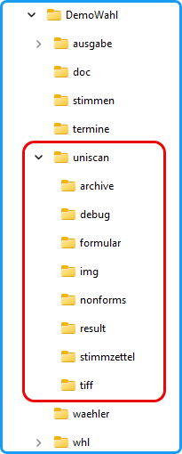

In der Abbildung ist die Dateistruktur dargestellt, wobei die Struktur für das Arbeitsverzeichnis steht, das über das Menü `Konfiguration` gewählt wird. Das Arbeitsverzeichnis vor dem Erstellen der Stimmzettel einrichten! Für einen neuen Wahlvorgang sollte ein neues Verzeichnis angelegt werden.

Bei dem *uniSCAN*-Verfahren wird in dem Arbeitsverzeichnis ein Ordner „*uniscan*“ angelegt, falls er noch nicht existiert, der die folgenden Ordner enthält:
|  |  |
|---|---|
|   Abb. : Datei-Struktur | **archive**: Hier werden die Bilddateien der Stimmzettel-Stapel nach der Analyse abgelegt.  **debug:** Im Debug-Modus werden hier die Debug-Dateien abgelegt.  **formular:** Formularbeschreibungsdateien  **img**: Bilddateien der einzelnen Stimmzettel  **nonforms**: Nicht analysierbare Stapel  **result**: *uniSCAN* schreibt die Ergebnisse hinein.  **stimmzettel**: Stimmzettel im *odt-* bzw. *docx*-Format  **tiff**: In diesem Ordner erwartet *uniSCAN* die gescannten tiff-Dateien zur Analyse; dieser muss als Zielordner des Scanprogramms angegeben werden.  **Hinweis**: Während der Analyse der Stimmzettel werden viele Grafik-Dateien erzeugt und abgelegt. Wenn das Arbeitsverzeichnis auf einem Netzlaufwerk liegt, kann es zu Geschwindigkeitsverlusten kommen. |
