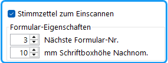
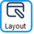

Die *uniSCAN*-Stimmzettel werden grundsätzlich im *ODT*-Format (*OpenOffice*, *LibreOffice*) generiert, auch wenn sonst *MS-Word* benutzt wird. Neben A4 ist auch A5 und A3 möglich.

Die Stimmzettel werden über das *Ausgabe*-Menü oder den *Layout*-Dialog erzeugt.

Dafür müssen folgende Vorbereitungen getroffen sein:

- Das Arbeitsverzeichnis muss vorher eingerichtet sein, damit die Formularbeschreibung in den richtigen *formular-*Ordner abgelegt wird.
- Im Menü `Ausgabe// / //Stimmzettel` (Abb.) oder im `Layout`-Dialog (Abb.) muss die Option: `Stimmzettel zum Einscannen` gewählt sein.

*Abb. : Layout uniSCAN-Stimmzettel*

- Im Dialog *Textbausteine* (Menü `Konfiguration// ///Textbausteine`) kann der Hinweis für das Markieren bearbeitet werden.
- Bitte beachten, dass gedruckte Texte nicht zu nah an den Kästchen stehen.

## Barcode {#barcode}

Die erste Zeile stellt binär die FormularID dar, die auch links im Klartext steht, z.B. die Nr. 37 wird binär dargestellt: 100101, wobei die 1 schwarz ist. Die 2. Zeile ist bei *uniWAHL* identisch. In der 3. Zeile stehen im 7. Bit von rechts die Seitennummer, bei Stimmzetteln immer 1, und die 3 Bits rechts sind die Paritätswerte von Seitennummer, FormularID und UmfrageID.

## Layout-Dialog {#layout-dialog}

Öffnen Sie den Layout-Dialog mit  oder über das Menü *Konfiguration**/Layout der Dokumente* und wählen den Reiter `Stimmzettel`.

Sobald Sie: `Stimmzettel zum Einscannen` gewählt haben, erscheinen weitere *uniSCAN*-Optionen:

**Nächste Formular-ID:** Kennung für den nächsten Stimmzettel. Diese wird automatisch erhöht.

| Achtung: Verändern Sie diesen Wert während eines Wahlvorgangs möglichst nicht. Dadurch könnten wichtige Dokumente überschrieben werden. |
|---|

**Schriftboxhöhe Nachnom.:** Die Höhe der Schriftbox für das Nachnominieren von Kandidat:innen bei `Wahl ohne Bindung an Kandidat:innen` kann festgelegt werden.
