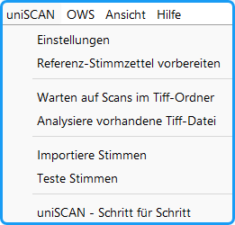

*Abb. : Menü uniSCAN*

**Einstellungen**: Einstellungen der Parameter für den Analysevorgang

**Referenz-Stimmzettel vorbereiten**: Für das Auffinden unerlaubter Zusätze und die Bestimmung einiger Parameter wie die Größe des Analysebereichs wird ein Satz von leeren Stimmzetteln als Referenz-Stimmzettel vorbereitet und analysiert.

**Warten auf Scans im Tiff-Ordner**: Das Programm wartet auf neue Stimmzettel-Stapel. Nach Eintreffen einer neuen Datei beginnt die Analyse (siehe Kap. 11.9.1 .)

**Analysiere vorhandene Tiff-Dateien**: Öffnet Dialog für die Auswahl der zu analysierenden Datei.

**Importiere Stimmen**: Eine vorher erzeugte Ergebnisdatei wird importiert bzw. getestet.

**Teste Stimmen**: Die Integrität von Daten und Wahlkennung wird getestet.

**uniSCAN - Schritt für Schritt:** Öffnet eine Anleitung zur schrittweisen Nutzung des Programms.
