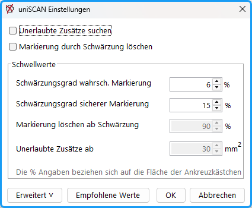
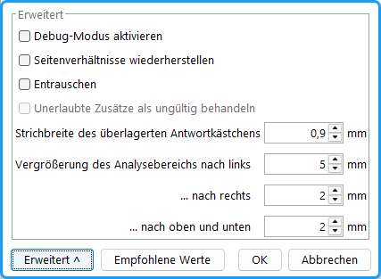

Unter Menü: `uniScan/ Einstelungen` können sie die Parameter bearbeiten.

- **Unerlaubte Zusätze suchen:** In dieser Betriebsart werden handschriftliche Zusätze gesucht, die den Stimmzettel ungültig machen würden. Dazu muss vorher ein Satz von leeren Stimmzetteln (möglichst mit demselben Scanner) eingescannt und mit dem Menübefehl *„Referenzstimmzettel vorbereiten“* bearbeitet werden. Diese stehen dann ausgerichtet und beschnitten in dem *formular*-Ordner. In dieser Betriebsart wird für jeden Stimmzettel die Differenz zum Referenzstimmzettel erzeugt, die nur die handschriftlichen Ergänzungen enthält. Außerhalb des Kästchenbereichs handelt es sich um unerlaubte Zusätze. Im Schriftbereich sind sie nur schwer festzustellen.
- **Markierung durch Schwärzung löschen:** Durch vollständiges Schwärzen wird die Stimmabgabe rückgängig gemacht.

 Abb. : uniSCAN Einstellungen

## Schwellwerte {#schwellwerte}

Die Schwellwerte geben an, ab welchem Schwärzungsgrad die Felder als angekreuzt gelten. Die %-Werte werden bezogen auf die Fläche der Kästchen; da auch Schwärzungen außerhalb der Kästchen mitgezählt werden, können auch Werte über 100% auftreten.

- **Schwärzungsgrad wahrsch. Markierung:** Ab diesem Füllungsgrad wird angenommen, dass das Feld angekreuzt wurde. (empf.: 6 - 10%).
- **Schwärzungsgrad sicherer Markierung:** Ab diesem Füllungsgrad wird als sicher angekreuzt angenommen (empfohlen: 15 - 20% oder niedriger).
- **Markierung löschen ab Schwärzung:** Die Markierung ab der angegebenen %-Zahl wird als nicht abgegeben gewertet. In diesem Fall wird nur die Schwärzung innerhalb des Kästchens gewertet (empfohlen: 90%).
- **Unerlaubte Zusätze ab**: Wenn diese Funktion gewählt wurde, gelten Stimmzettel mit Schwärzungen außerhalb der Ankreuzbereiche von mehr als der gewählten Zahl von Pixeln als ungültig.

## Erweitert {#erweitert}

Durch Klicken auf `Erweitert` vergrößert sich die Schaltfläche und weitere Parameter können bearbeitet werden.

- **Debug-Modus**: Die Stimmzettel werden mit Informationen der gefundenen Elemente in den Ordner *debug* geschrieben.
- **Seitenverhältnis wiederherstellen**: Wenn die Stimmzettel verkleinert ausgedruckt wurden, kann diese Option eingeschaltet werden. Damit wird Autoskalierung der Bilder aktiviert. In der Preprocessing Phase wird die rechteckige Arbeitszone aufgefunden und auf die richtige Größe skaliert. Somit wird die Größe eines Stimmzettels wiederhergestellt.
- **Entrauschen**: Mit dieser Funktion werden bei grauem Papier oder bei falscher Helligkeitseinstellung einzelne Pixel entfernt. (nicht Std.)
- **Unerlaubte Zusätze als ungültig behandeln:** Stimmzettel mit nicht erlaubten Ergänzungen, wie handschriftlichen Notizen oder Eintragungen werden dadurch automatisch als ungültig wertet.
- **Strichbreite des überlagerten Antwortkästchens:** Wie mit einem Tintenkiller wird der Rahmen des Kästchens gelöscht. Wenn bei größeren Schwankungen der Scans Anteile des Rahmens als Schwärzung mitgezählt werden, kann dieser Parameter vorsichtig vergrößert werden.
- **Vergrößerung des Analysebereichs nach ...**: Vergrößerung des Analysebereichs gegenüber den Kästchen (Empfohlen: links 5 mm, rechts, oben, unten 2 mm). Nach unten und oben wird maximal der halbe senkrechte Abstand der Kästchen genommen.
