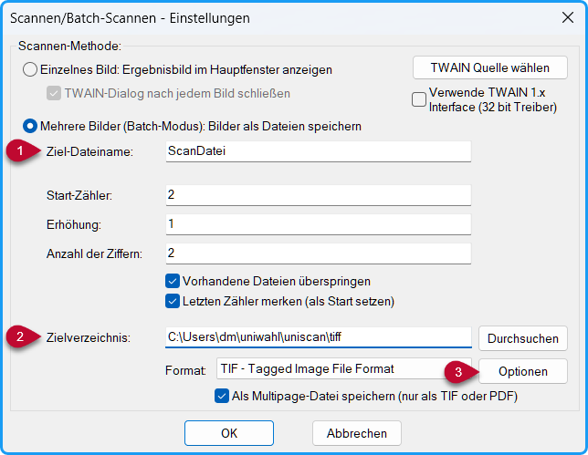
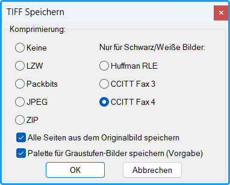
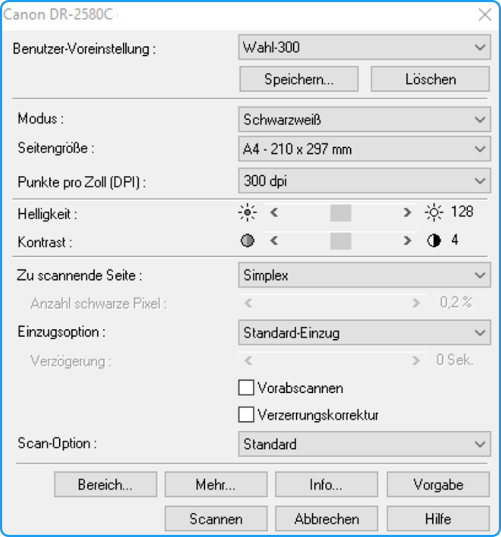

Zum Einscannen kann ein beliebiges Scanner-Programm benutzt werden, z.B. das beim Dokumentenscanner mitgelieferte Programm oder die frei verfügbaren Programme *IrfanView* oder *XnView*.

**Einstellungen:**

- Ziel-Ordner: **&lt;Arbeitsverzeichnis&gt;\uniscan\tiff**, z.B. "C:\Users\username\uniwahl\uniscan\tiff"

**Format:**

- **TIFF-Multipage** (ein Stapel in einer Datei)
- Scan-Modus: **Schwarz-Weiß** (nicht Grautöne!)
- Auflösung: **(200 oder) 300 dpi** (nicht höher!)

**Seite:**
- **Simplex** (Nur die Vorderseite scannen), besser wäre **Duplex** (wenn die Scan-Software "Leere Seiten entfernen" anbietet)

**Kleine Kästchen**:
- Wenn wegen großer Zahl der Kandidat:innen kleine Kästchen benutzt werden, sollte die Auflösung **300 dpi** gewählt werden.

## Beispiel: IrfanView {#beispiel-irfanview}

1. **Wahl des Scanners:** Über das Menü **Datei &gt; TWAIN Quelle wählen…** wird der Scanner ausgewählt. 
1. **Einstellungen:** Über das Menü **Datei &gt; Scannen/Batch-Scannen...** werden die Parameter eingestellt und das Scannen gestartet.

*Abb.: IrfanView Scanner-Einstellungen*

1. **Ziel-Dateiname** (frei wählbar): Die erste Datei würde ScanDatei1 heißen, wobei die Nummer laufend erhöht wird. Der Name der Ergebnis-Datei ist dann entsprechend. Hier sind selbsterklärende Namen wie „Senat-Stud“ sinnvoll. 
1. **Ziel-Verzeichnis:** wie beschrieben: &lt;Arbeitsverzeichnis&gt;/uniscan/tiff 
1. **Optionen:** Öffnet Dialog für die TIFF-Codierung.

*Abb.: TIFF-Optionen*

**CCITT Fax 4**:
Kompressionsverfahren, liefert kleinere Dateien

## Beispiel: Einstellung der Scan-Parameter (abhängig vom Scannertyp) {#beispiel-einstellung-der-scan-parameter-abhaengig-vom-scannertyp}

*Abb.: Scanner-Einstellungen (Beispiel Canon DR-2580C)*

Die Voreinstellungen können gespeichert werden:

- Schwarzweiß, nicht grau!
- A4
- (200 - )300 dpi
- Schwarz ab 128 (Skala 0 - 255)
- Nur Vorderseite wird gescannt
