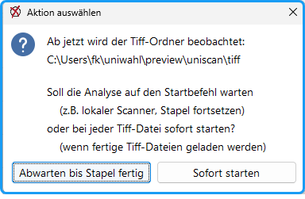
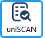
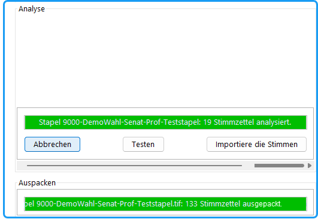

## Scannen {#scannen}

1. Eine Stapelgröße von ca. 200 Stimmzetteln ist handlich.
1. Mit dem Befehl „W*arten auf Scans im Tiff-Ordner*“ soll *uniWAHL* neue Dateien analysieren; dafür wird der *tiff*-Ordner auf neue Dateien beobachtet.
1. *uniWAHL* fragt, ob er auf einen zusätzlichen Startbefehl warten soll.

*Abb.: Tiff-Ordner beobachten*

Die Antwort hängt von der Betriebsart ab: Scanner ONLINE oder OFFLINE:

## Betriebsart Online: Lokaler Scanner am uniWAHL-Rechner {#betriebsart-online-lokaler-scanner-am-uniwahl-rechner}

- **Abwarten bis Stapel fertig**: Diese Option sollte bei lokalem Scanner gewählt werden, da beim Scannen ggf. (abhängig vom Scanprogramm) jede Seite abgelegt wird. Die Analyse soll erst beginnen, wenn der Stapel fertig gescannt ist. Man kann in dieser Betriebsart auch neue Stimmzettel nachlegen und den Stapel fortsetzen.

## Betriebsart Offline: Scannen an externem Scanner {#betriebsart-offline-scannen-an-externem-scanner}

Für die Bearbeitung großer Mengen von Stimmzetteln sollte man das Scannen auf einem externen Hochleistungs-Scanner durchführen. Auch kann man an verschiedenen Standorten scannen. Die Dateien werden per USB-Stick, E-Mail oder Netzlaufwerk auf den *uniWAHL*-Rechner gebracht und in den *tiff*-Ordner kopiert:

- **Sofort starten:** Die Analyse beginnt sofort, nachdem eine neue Datei (fertige Bilddatei *Tiff multipage*) im *tiff*-Ordner entdeckt wurde. Man kann auch mehrere Dateien/Stapel gleichzeitig hineinkopieren.

## Stimmzettelanalyse {#stimmzettelanalyse}

Nach dem Start der Analyse entpackt *uniSCAN* die Bilddateien. Im Dialog „Stimmzettelanalyse“ läuft der Fortschrittsbalken und wechselt beim Beenden die Farbe auf grün. Anschließend beginnt die Analyse des gesamten Stapels.

Nach Beendigung der Analyse wechselt der Balken auf grün und die Tasten für „Testen“ und „Importieren der Stimmen“ sind aktiv.

 Der *uniSCAN*-Analysedialog kann mit der *uniSCAN*-Schaltfläche in der Werkzeugleiste an- und ausgeschaltet werden.

*Abb.: Stimmzettelanalyse*

## Nach der Analyse: Daten testen oder importieren {#nach-der-analyse-daten-testen-oder-importieren}

- **Testen**: Zu Beginn sollte die Analyse zuerst getestet werden. Dabei werden die Stimmen nicht an die Personen übergeben, aber das Protokoll wird erstellt, das gründlich geprüft werden sollte.
- **Importieren**: Die Ergebnisse werden an die Personen übergeben und das Protokoll erstellt.
