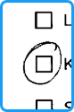
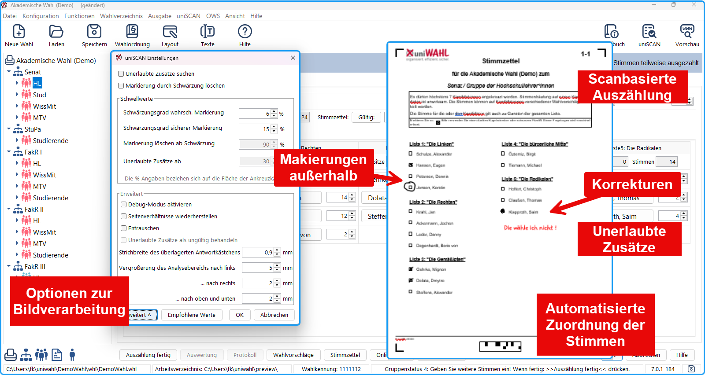

import DocCardList from '@theme/DocCardList';

Mit uniWAHL und dem Modul // ist es möglich, eingescannte Stimmzettel automatisch auswerten zu lassen.

|  |  |
|---|---|
|  | Das Verfahren analysiert die Schwärzung innerhalb der Ankreuzkästchen *und in deren Umgebung* (Analysebereich). Dadurch werden Markierungen neben dem Kästchen, aus denen das menschliche Auge den Wähler:innenwillen erkennen würde, als gültige Stimmen erkannt. |

Außerdem bietet das Verfahren die Möglichkeit, zusätzliche Bemerkungen auf den Stimmzetteln, die diese ungültig machen würden, zu erkennen.

<DocCardList />

