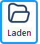

Mit der Funktion `Wahlvorgang laden` öffnen Sie eine zuvor erstellte oder bereitgestellte Wahlkonfiguration (**WHL-Datei**) in der Software. In uniWAHL geschieht das auf Basis der Datei-Endung **.whl** – dem speziellen Format für Wahlvorgänge im Einplatzbetrieb. Die .whl-Datei enthält alle relevanten Informationen eines Wahlprojekts in komprimierter Form: Struktur, Einstellungen, Kandidaten, Texte, Layouts und ggf. Zwischenergebnisse. Dadurch lässt sich der komplette Wahlvorgang als Datei sichern, archivieren oder auf einem anderen System weiterverwenden.

Diese Funktion erlaubt es Ihnen, zu einem beliebigen Zeitpunkt an einem bereits vorbereiteten Wahlvorgang weiterzuarbeiten – sei es zur Kontrolle, zur Anpassung oder zur Durchführung weiterer Wahlgänge. Der große Vorteil: Sie sparen Zeit bei der Einrichtung, vermeiden wiederholte Eingaben und sorgen für eine konsistente und nachvollziehbare Wahlbearbeitung. Besonders in komplexeren, sich wiederholenden Wahlprojekten ist diese Funktion ein zentraler Bestandteil eines reibungslosen Ablaufs.

1. Betätigen Sie die Taste    in der Werkzeugleiste oder Menübefehl `Datei / Öffnen`.
1. Überschreiben Sie den bisher geladenen Wahlvorgang, falls vorhanden.
1. Selektieren Sie in dem sich öffnenden Auswahlfenster „**DemoWahl.whl**“ und bestätigen Sie mit „Öffnen“. Der neue Wahlvorgang ist jetzt geladen.
1. Geben Sie dem zu bearbeitenden Wahlvorgang einen neuen Namen: Rufen Sie im Menü `Datei / Speichern unter...` auf und wählen Sie einen neuen, passenden Namen.

:::tip

Die Möglichkeit zur Versionierung ergibt sich aus dem Arbeiten mit Kopien dieser Dateien.

Indem Sie Wahlvorgänge unter verschiedenen Namen abspeichern (z. B. DemoWahl_V1.whl, DemoWahl_final.whl oder Testwahl_Juni2025.whl), dokumentieren Sie den Bearbeitungsstand. Dies schützt vor unbeabsichtigten Änderungen, macht den Fortschritt nachvollziehbar und bietet Ihnen die Option, jederzeit auf eine frühere Version zurückzugreifen.

:::
