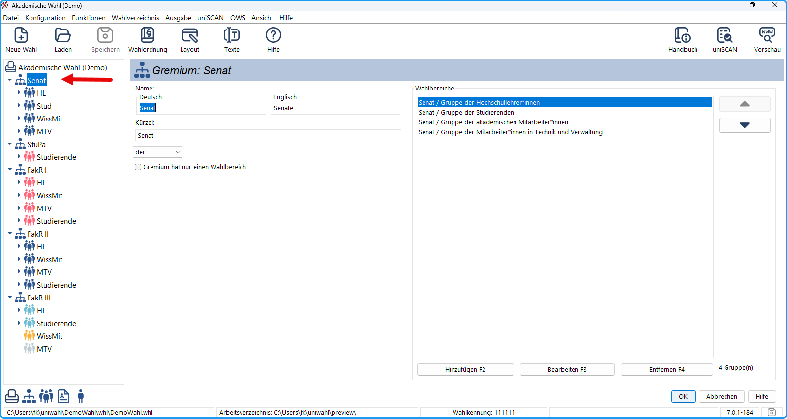

Um einen Wahlbereich, ein Gremium oder ein anderes Element zu bearbeiten, müssen Sie das entsprechende Dialogfenster öffnen:

*Abb. : Gremium öffnen*

Wählen Sie im Navigationsbereich das jeweils zu bearbeitende Element (*Wahl / Gremium / Wahlbereich / Liste / Kandidat:in*) aus, indem Sie auf die Bezeichnung **doppelklicken**.
