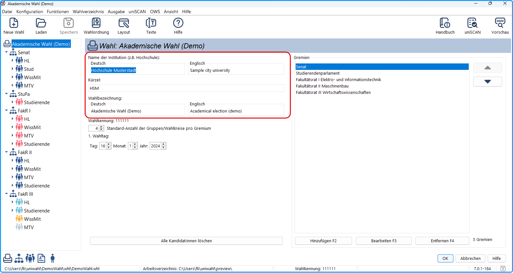
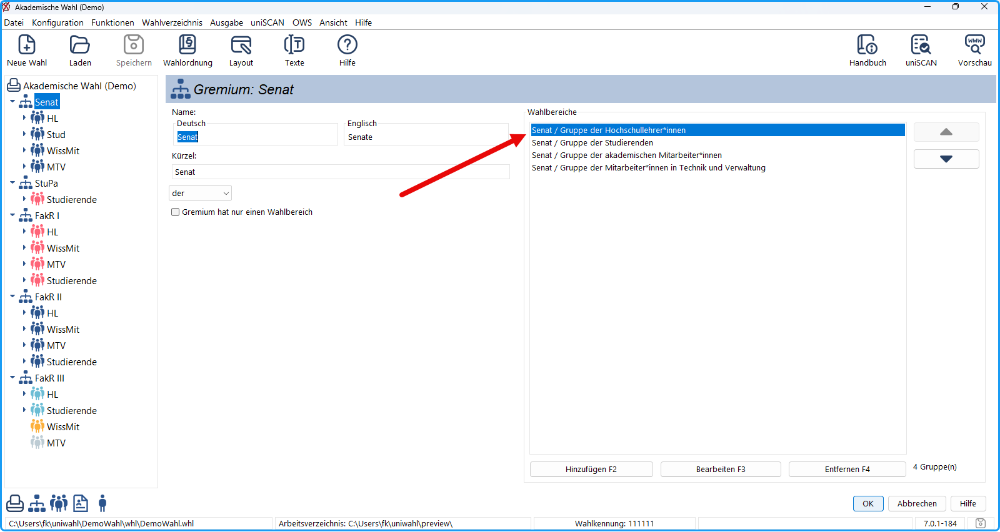
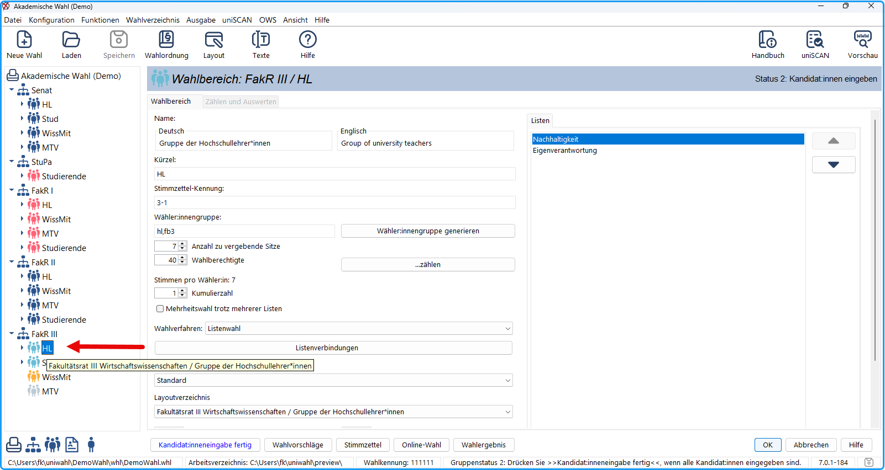

1. Doppelklick auf das Wahl-Symbol  im Navigationsfenster öffnet das Fenster `Wahl`.
1. Geben Sie den ausführlichen und gekürzten Namen der Hochschule oder Organisation an. Die Kürzel werden nur programmintern benutzt.
1. Geben Sie dem Wahlvorgang einen Namen, z.B. „Akademische Wahl &lt;Jahreszahl&gt;“.

*Abb. : Wahlvorgang bearbeiten*

1. In der Liste rechts stehen die Namen der Gremien: Wählen Sie „Fakultätsrat II Maschinenbau“.
1. Durch Doppelklick oder Betätigen der Taste `Bearbeiten F3` öffnet sich das Fenster für das ausgewählte Gremium. (Sie können auch im Navigationsfenster auf das Gremium „FakR II“ doppelklicken.)

*Abb. : Gremium bearbeiten*

1. Geben Sie den Namen und das Kürzel (und Artikel) des Gremiums ein.
1. Im rechten Teil des Eingabefensters sehen Sie eine Liste der Wahlkreise dieses Gremiums. Wählen Sie „Gruppe der Hochschullehrer*innen“ durch Einfachklick und Taste `Bearbeiten F3` oder durch Doppelklick.
1. Alternativ können Sie auch im Navigationsfenster die Gruppe wählen.

Es öffnet sich das Fenster des ausgewählten Wahlbereichs.

*Abb. : Wahlbereich bearbeiten*

1. Für jeden Wahlbereich legen Sie die Zahl der Sitze und die Anzahl der Wahlberechtigten fest.
1. Nachdem alle Gremien in dieser Weise bearbeitet wurden, bestätigen Sie mit `OK` .

Wenn Sie alle Gremien deklariert haben, erfolgt die Wahlausschreibung. Die Wahlberechtigten geben ihre Wahlvorschläge ab.

Auf diesen aktuellen Wahlbereich beziehen sich alle folgenden Bearbeitungen.

## Wahlbereich spezifizieren {#wahlbereich-spezifizieren}

1. Wählen Sie einen Wahlbereich, z.B. FakR II / Gruppe der Hochschullehrer*innen.
1. Die Anzahl der zu vergebenden Sitze und der Wahlberechtigten wird eingegeben.
1. Die Anzahl der Stimmen pro Wähler:in ergibt sich aus der Wahlordnung.
1. Sobald die Wahlvorschläge vorliegen, bestimmen Sie das Wahlverfahren (Mehrheits- oder Verhältnis-/Listenwahl). Wählen Sie z.B. für *FakR II/HL* vielleicht *Mehrheitswahl* und für *FakR II/Studierende: Listenwahl.*
