Diese Anleitung beschreibt den Prozess der Scanverarbeitung mit uniSCAN.

Lesen Sie bitte *vor* dem Erstellen der Stimmzettel zum Einscannen diese Anleitung aufmerksam durch.

#### uniSCAN-Verfahren {#uniscan-verfahren}

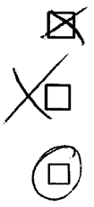
- Mit uniWAHL und dem Modul uniSCAN werden eingescannte Stimmzettel automatisch anhand eines sog. OMR-Verfahrens ausgewertet.
- Das Verfahren analysiert die Schwärzung innerhalb der Ankreuzkästchen und in deren Umgebung. Dadurch werden Markierungen neben dem Kästchen, aus denen der Wählerwille erkennbar ist, als gültige Stimmen erkannt.
- Das Verfahren ist sehr empfindlich und erkennt auch schwache Markierungen.
- Handschriftliche Bemerkungen auf den Stimmzetteln, die diese ungültig machen, können erkannt werden.

#### Betriebsarten von uniSCAN {#betriebsarten-von-uniscan}

**A: Online-Modus**

Der (Einzug-)Scanner ist *direkt (per USB)* an dem uniWAHL-Computer angeschlossen:
- Im Scan-Programm setzen Sie als Zielordner: [**../uniscan/tiff**] in Ihrem Arbeitsverzeichnis.
- Menü [**uniSCAN**] wählen Sie: [**Warten auf Scans im Tiff-Ordner**] und [**Abwarten bis Stapel Fertig**].
- Wenn der Stapel fertig gescannt ist, geben das Startsignal zum Analysieren durch Klick auf [**OK**].

**B: Offline-Modus**

Sie benutzen einen *externen Scanner*, z.B. an verschiedenen Standorten:

- Transferieren Sie die Tiff-Dateien per USB-Stick, eMail oder Netzlaufwerk in den Ordner [**.../uniscan/tiff**] in Ihrem Arbeitsverzeichnis auf dem uniWAHL-Rechner.
- Wenn Sie vorher im Menü uniSCAN gewählt haben: [**Warten auf Scans im Tiff-Ordner**] und
- [**Sofort starten**], analysiert uniSCAN die dort abgelegten Dateien sofort.
- Oder: Sie arbeiten die Stapel nacheinander ab, indem Sie im Menü [**uniSCAN / Analysiere vorhandene Tiff-Datei**] wählen.

uniSCAN wird direkt in uniWAHL ausgeführt. Es ist wichtig, dass beim Einlesen der Stimmzettel die Wahlprojekt-Datei (Endung *.WHL) geöffnet ist, aus der die Stimmzettel ursprünglich erzeugt wurden. Arbeiten Sie am besten nur mit *einer* WHL-Datei, um Kontextwechsel zu vermeiden.

## Erster Test - Ausprobieren mit Beispieldateien {#erster-test-ausprobieren-mit-beispieldateien}

- Starten Sie uniWAHL. Öffnen Sie die **DemoWahl.whl** (...\whl\beispiele).
- Öffnen Sie das Menü [**uniSCAN / Einstellungen**].
- Testen Sie zuerst *ohne* die Häkchen bei [**Unerlaubte Zusätze suchen**] und [**Markierung durch Schwärzung löschen**].
- Klicken Sie auf [**uniSCAN / Analysiere vorhandene Tiff-Datei**].
- Wählen Sie den Stapel: ..\uniscan\archive\9000-DemoWahl-Senat-Prof-Teststapel.tif
- Warten Sie bis das Auspacken und die Analyse fertig sind: Der Fortschrittsbalken wird grün.
- Klick auf [**Analyse / Testen**]: Kontrollieren Sie das Import-Protokoll (Auszählungsprotokoll).
- Wiederholen Sie die Analyse mit Häkchen bei [Unerlaubte Zusätze suchen] und [Markierung durch Schwärzung löschen].
Sie werden feststellen, dass je nach Einstellung geänderte Ergebnisse vorliegen können.

## Arbeitsverzeichnis einstellen {#arbeitsverzeichnis-einstellen}

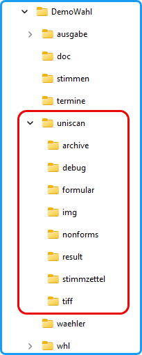

Bei dem *uniSCAN*-Verfahren wird in dem Arbeitsverzeichnis ein Ordner „uniscan" angelegt, falls er noch nicht existiert, der die folgenden Ordner enthält:

**archive**: Hier werden die Bilddateien der Stimmzettel-Stapel nach der Analyse abgelegt.

**debug**: Im Debug-Modus werden hier die Debug-Dateien abgelegt.

**formular**: Formularbeschreibungsdateien

**img**: Bilddateien der einzelnen Stimmzettel

**nonforms**: Nicht analysierbare Stapel

**result**: *uniSCAN* schreibt die Ergebnisse hinein.

**stimmzettel**: Stimmzettel im odt- bzw. docx-Format,

**tiff**: In diesem Ordner erwartet *uniSCAN* die gescannten tiff-Dateien zur Analyse; dieser muss als Zielordner des Scanprogramms angegeben werden.

**Hinweis**: Während der Analyse der Stimmzettel werden viele Grafik-Dateien erzeugt und abgelegt. Wenn das Arbeitsverzeichnis auf einem Netzlaufwerk liegt, kann es zu Geschwindigkeitsverlusten kommen.
Abb.: uniSCAN Arbeitsverzeichnis
- uniSCAN legt Dokumente (Scan-Dateien, Protokolle, XML-Erkennungssets, Debug-Stimmzettel) im Arbeitsverzeichnis von uniWAHL im Ordner [uniscan] ab.
- Starten Sie uniWAHL.
- Öffnen Sie eine bestehende whl-Datei bzw. nutzen Sie eine Kopie zum Testen.
- Über den Menübefehl [**Konfiguration / Arbeitsverzeichnis**] stellen Sie das Arbeitsverzeichnis ein. Dabei werden die benötigten Unterverzeichnisse automatisch eingerichtet und die Testdateien dort hinterlegt.
- Prüfen Sie die oben beschriebene Ordner-Struktur von uniSCAN.

Legen Sie vor einem neuen Wahlvorgang ein neues Verzeichnis an. Ändern Sie während der Bearbeitung des Wahlvorgangs das Arbeitsverzeichnis möglichst nicht mehr.

## Stimmzettel erstellen {#stimmzettel-erstellen}

Die uniSCAN-Stimmzettel werden im DOCX- oder ODT-Format erzeugt, so dass Microsoft Word bzw. OpenOffice oder LibreOffice installiert sein muss.

- Aktivieren Sie im Menü [**Ausgabe / Stimmzettel**] oder im Dialog [**Layout**] die Option [**Stimmzettel zum Einscannen**] und starten Sie die Ausgabe.
- Beachten Sie den „Achtung!“-Dialog! Wenn der Stimmzettel in Ordnung ist, beantworten Sie: „Soll er in dieser Form übernommen werden?“ ***unbedingt*** mit [Ja].
- Erst jetzt wird die Formular-ID vergeben und die XML-Erkennungsdatei in den [**formular**]-Ordner geschrieben. Prüfen Sie, ob sich zu jeder Stimmzettel-ID (auf dem Stimmzettel links unten) eine entsprechende XML-Datei dort befindet.

Ändern Sie während eines Wahlvorgangs die Formular-ID ***nicht*** manuell!
Ändern Sie Scan-Markierungen (Eckwinkel, Barcodes, Kästchen) ***nicht*** manuell nachträglich in Microsoft Word, OpenOffice oder LibreOffice!
Geben Sie nur Stimmzettel an Wählende aus, deren Formular-ID Sie vorher geprüft und mit denen Sie wenigstens einen **Test-Scan** durchgeführt haben!

&gt; Für die folgenden Tests empfehlen wir zunächst die Erstellung einer **Sicherungskopie** Ihrer whl-Datei über das Menü [**Datei / Speichern unter**…] – neuer Dateiname.

## Scan-Programm einrichten {#scan-programm-einrichten}

- Starten Sie Ihr Scan-Programm. Wählen Sie die TWAIN Quelle: &lt;Ihr Scanner&gt;.
- Nehmen Sie die Einstellungen vor:
   - Mehrere Bilder **Multipage-TIF**
   - Ziel-Dateiname: Beliebig wählbar
   - Ziel-Ordner: **.../uniscan/tiff**
   - Format: **TIF**
   - TIFF-Multipage eine Datei pro Stapel speichern
- Passen Sie die Optionen an:
   - Komprimierung: z.B.„CCITT Fax 4‟ erzeugt die kleinsten Dateien
- Passen Sie im Scanner-Dialog an:
   - **Schwarz-Weiß-Modus** (1 bit pro Pixel, ***nicht*** grau!)
   - **200 - 300 dpi**
   - **Papierformat A4** etc.
   - **Duplex** (doppelseitig scannen, **leere Seiten entfernen**)
   - Bei farbigem Papier ggf. **Blindfarbenfilterung** („Color-Dropout“)
- Klicken Sie auf [Scannen] oder richten Sie die Software so ein, dass Sie direkt am Scanner per Tastendruck einscannen können.

## Test: Leere Stimmzettel {#test-leere-stimmzettel}

- Erstellen Sie einen Stapel mit je einem leeren Stimmzettel her und nennen ihn z.B. „Leer“ oder „Referenzstimmzettel“. Scannen Sie ihn in den [**uniscan/tiff**]-Ordner.
- Entfernen Sie vorher in uniWAHL unter [**uniSCAN / Eigenschaften**] das Häkchen bei [**Unerlaubte Zusätze suchen**].
- Analysieren und testen (***nicht*** importieren) der TIF-Dateien. Alle Stimmzettel müssen ungültig sein.

## Referenz-Stimmzettel vorbereiten (optional) {#referenz-stimmzettel-vorbereiten-optional}

Referenz-Stimmzettel (Leere Exemplare im Original-Scan) werden benötigt, wenn man unerlaubte Zusätze suchen will: Zusätzlich werden auch andere Parameter der Stimmzettel wie die Größe der Analysebereiche hierüber bestimmt.
- Menü [**uniSCAN / Referenzstimmzettel vorbereiten**]: Geben Sie den vorher eingescannten Stapel leerer Stimmzettel an, er wurde nach der Analyse in den [**uniscan/archive**]-Ordner kopiert.
- Setzen Sie nun ggf. das Häkchen bei [**Unerlaubte Zusätze suchen**], wenn Sie diese Option nutzen wollen.

## Test: Ausgefüllte Stimmzettel {#test-ausgefuellte-stimmzettel}

- Stellen Sie einen Stapel mit mehreren Stimmzetteln von allen Typen her und füllen Sie diese aus. Probieren Sie typische Markierungen am Stimmzettel aus.
- Scannen Sie die Stimmzettel mit einem Scanprogramm (siehe oben) ein.
- Menü [**uniSCAN / Analysiere vorhandene Tiff-Datei**]: Bitte ***nur*** auf [**Teste Stimmen**] klicken, damit keine Stimmen etc. übernommen werden.
- Kontrollieren Sie im Auszählungsprotokoll die analysierten Stimmen und die ungültigen Stimmzettel.
Passen Sie die Einstellungen in uniWAHL in [**uniSCAN / Einstellungen**] so an, dass die Ergebnisse im Auszählungsprotokoll den gescannten Bilddateien entsprechen (z.B. Schwärzungsgrad, Korrekturen vorhanden, Bildrauschen vorhanden). ***Erst dann*** importieren Sie die Stapel!

## Problembehandlung {#problembehandlung}

1. **Stimmzettel konnte nicht gelesen werden**
   1. Ist für jeden Stimmzettel-Typ (FormID links unten auf dem Stimmzettel) eine xml-Datei mit derselben Nummer als Name im [**uniscan**/**formular**]-Ordner?
   1. Sind die Scan-Markierungen am Stimmzettel alle vorhanden. Mindestens 3 **Eckwinkel** müssen erkannt werden, damit die Ausrichtung stimmt. Der **Barcode** muss vorhanden und unbeschädigt sein.
   1. Sind die Stimmzettel maßhaltig ausgedruckt? Beim PDF-Druck: Keine Anpassung der Seitengröße, es muss auf [**tatsächliche Größe**] gedruckt werden.
   1. Sind pdf- und docx- bzw. odt-Ausdrucke identisch? (**Fensterscheibentest**).
   1. Gehört der Stimmzettel ggf. zu einem anderen Wahlvorgang (WHL-Datei)?

1. **Debug Modus einschalten**
   1. Unter dem Menü [**uniSCAN / Einstellungen**] aktivieren Sie [**Debug-Modus**] in den erweiterten Einstellungen.
   1. Im Ordner […/**uniSCAN/debug**] werden anschließend für jeden Stimmzettel Bilder mit dem Analyseergebnis abgelegt. Prüfen Sie diese Bilder, um etwaige Scanprobleme zu erkennen.&lt;/ol&gt;

## Hinweise zur Verarbeitung der Stimmzettel {#hinweise-zur-verarbeitung-der-stimmzettel}

Die Stimmzettel werden in uniWAHL als Stimmzettel zum Einscannen (wie oben beschrieben) produziert und enthalten die typischen Scanmarkierungen (Eckwinkel, Barcode, Kästchen). Die Markierungshinweise für eine scannerbasierte Auszählung sollten daher in der Wahlbekanntmachung, als Aushang und Beilage zu Briefunterlagen genutzt werden.

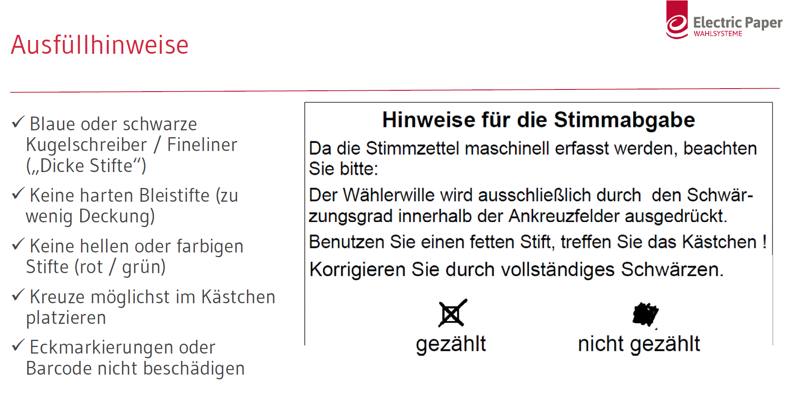
Abb.: Ausfüllhinweise zur scanbasierten Auszählung

Die Markierungshinweise auf den Stimmzetteln in uniWAHL sind textuell zu überarbeiten. Insbesondere der Korrekturhinweis („Vollständig ausfüllen“ zur Korrektur) sollte ergänzt werden, wenn diese Option [**uniSCAN / Einstellungen / Markierung durch Schwärzung löschen**] gewünscht ist. Der uniWAHL Markierungshinweis (z.B. „Schwarzer oder blauer Kugelschreiber oder Fineliner, kein Edding, keine Korrekturflüssigkeit“) sollte überprüft bzw. in den Textbausteinen in uniWAHL auf den Stimmzetteln ergänzt werden.

Da während einer Stimmzettelanalyse auch Markierungen außerhalb der Kästchen innerhalb des sog. **Analysebereichs** erkannt werden, sollten die Abstände der Kästchen im Scanverfahren größer sein. Stellen Sie dies in uniWAHL in [**Konfiguration / Layout der Dokumente**] ein, bevor Sie die Stimmzettel drucken. Nachträglich können Sie den Analysebereich in [**uniSCAN / Einstellungen / Erweitert**] so anpassen, dass der den gescannten Bilddateien entspricht.

Achten Sie auch darauf, dass die Kästchen auf den Stimmzetteln ausreichend Abstand haben und ***NICHT*** in Papierfalzen liegen, da somit durch häufiges Falten Beschädigungen der Kästchen auftreten können oder Scan-Fehler durch welliges Papier nach dem Falten.

In der maschinellen Auswertung (OMR-Verfahren) wird der Wählerwille durch den Schwärzungsgrad innerhalb der Kästchen ausgedrückt. Farbiges Papier (insbesondere dunkle Farben) behindern die scanbasierte Auszählung, da die Hintergrundfarbe von der Scan-Software herausgerechnet werden muss. Es entsteht dadurch insgesamt eine schwächere Schwarzabdeckung innerhalb der Kästchen. Zugleich behindern dunkle Farben (rot als Signalfarbe) auch die Stimmabgabe, da somit Kästchen und Kreuze schlechter erkennbar sind. Wir empfehlen daher farbige Markierungen nur in Randbereichen aufzudrucken, z.B. über die Funktion [Stimmzettelfarbe] im Layout-Menü von uniWAHL.

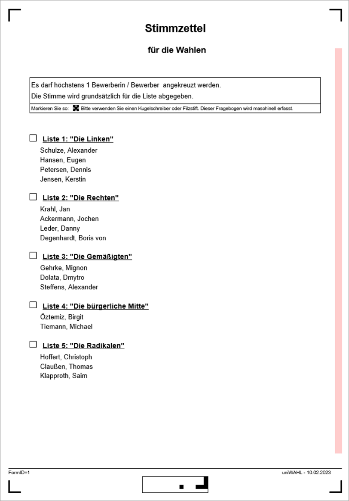
Abb.: uniSCAN Stimmzettel mit Scanmarkierungen und farblicher Markierung

## #1 Vorsortieren {#1-vorsortieren}

Das Vorsortierung erfolgt nach dem Öffnen der Wahlumschläge bzw. Wahlurnen durch Mitarbeiter der Wahlorganisation, insbesondere durch den Wahlvorstand und/oder durch Wahlhelfer.

Die Anzahl der angekreuzten Kandidierenden wird im Rahmen der Scanauswertung automatisch ermittelt, ein manuelles Auszählen der Stimmzettel und einzelnen Markierungen ist ***NICHT*** notwendig!

Es gibt im Rahmen der ersten Vorsortierung die folgenden Möglichkeiten der Zuordnung:

### Offensichtlich gültige Stimmzettel {#offensichtlich-gueltige-stimmzettel}

**Offensichtlich gültig**: Die Stimmzettel werden in einem automatischen Scanverfahren verarbeitet, Durchlaufen der Sichtprüfung nur bei vom System erkannten Unklarheiten.

**Unklar**

### Unklare Stimmzettel (GELB, alle anderen) {#unklare-stimmzettel-gelb-alle-anderen}

Die unklaren Stimmzettel werden durch den Wahlvorstand weiter klassifiziert. I.d.R. wird nur ein sehr geringer Anteil der Stimmzettel im ersten Sortierungsprozess als unklar bewertet. Im Rahmen der weiteren Vorsortierung gibt es wiederum zwei Möglichkeiten der Zuordnung.

:::note

**Offensichtlich gültig**: Automatisches Scanverfahren, jeder Stimmzettel durchläuft aber in diesem Fall die Sichtprüfung

:::

**Ungültig**: Die ungültigen Stimmzettel werden ebenfalls gescannt, es wird aber lediglich im Scanverfahren die Anzahl ermittelt

## Offensichtlich gültige Stimmzettel {#offensichtlich-gueltige-stimmzettel}

Je nach Vorgabe der Wahlordnung sind offensichtlich gültige Stimmzettel wie folgt gekennzeichnet:

**Offensichtlich gültig**
   - Der Wählerwille ist zweifelsfrei erkennbar und es sind keine unerlaubten Zusätze sichtbar.
   - Die Stimmzettel enthalten lediglich in den dafür vorgesehenen Feldern Markierungen.
   - Es gibt *keine* Korrekturen von Feldern oder Korrekturen sind in der Verarbeitung vorgesehen (Markierungshinweise)
   - Es sind *keine* zusätzlichen Kommentare auf dem Stimmzettel

Für die Vorbereitung zum Scannen sind die folgenden Tätigkeiten auszuführen:

- Es werden Scanstapel zwischen 50 und 100 Seiten gebildet.
- (optional) Die Stapel werden nach WHL-Datei, Wahlbereich (z.B. farbliche Markierung) sortiert.
- (optional) Wenn eine Wahlbeteiligung pro Stimmbezirk / Wahllokal erfasst werden soll, sind die Stapel entsprechend zu sortieren.
- Es wird empfohlen im Duplex-Modus zu verarbeiten und leere Seiten zu entfernen. Die Scan-Verarbeitung dauert dadurch länger, die Stapel müssen aber nicht nach Vorderseite sortiert werden.
- Die Seiten sollten glatt sein, keine geknickten Ecken.
- Die Verarbeitung erfolgt anschließend durch Einlesen in uniSCAN automatisch. Mögliche Ungereimtheiten werden erkannt und im Sichtprüfungsprozess dem Wahlvorstand am Bildschirm zur Bewertung vorgelegt.

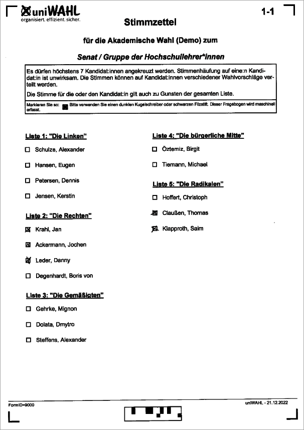

Abb.: Gültiger, gescannter Stimmzettel – Die Kreuze sind eindeutig zu erkennen

## Unklare Stimmzettel (alle anderen) {#unklare-stimmzettel-alle-anderen}

Alle anderen unklaren Stimmzettel sind durch einen oder mehrere der folgenden Merkmale klassifiziert.

**Unklar**

   - Leere Stimmzettel
   - Die Markierung des Wahlvorschlages erfolgt nicht an den dafür vorgesehenen Stellen.
   - Wählerwille ist erkennbar, aber Markierungsfelder sind nicht verwendet worden.
   - Der eindeutige Wählerwille ist nicht erkennbar.
   - Der Stimmzettel ist mit einem besonderen Merkmal versehen.
   - Sonstige Zusätze, Kommentare oder Änderungen vorhanden.
   - Streichungen oder Korrekturen
   - Beschädigte und eingerissene Stimmzettel

Alle unklaren Stimmzettel werden im Rahmen einer weiteren Beurteilung durch den Wahlvorstand näher klassifiziert!

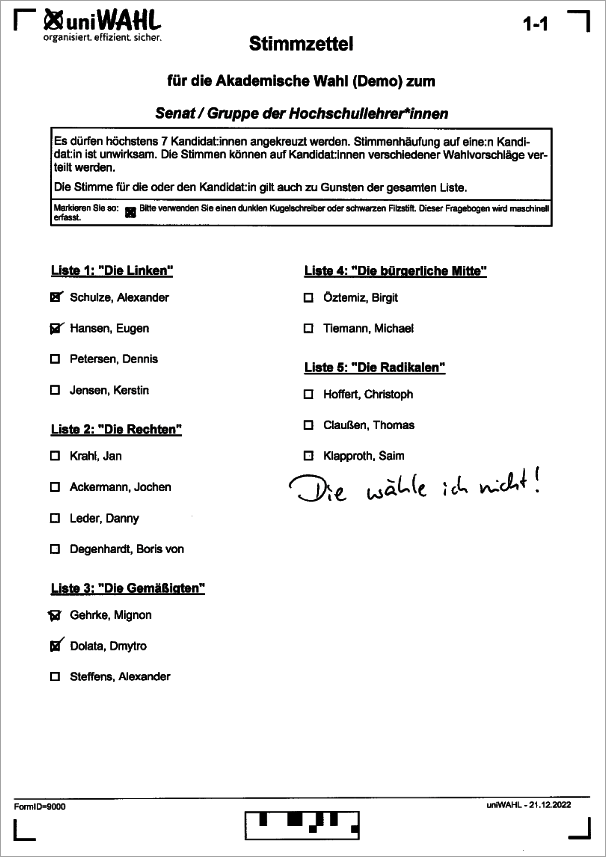
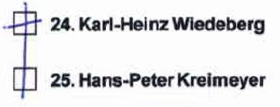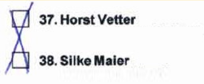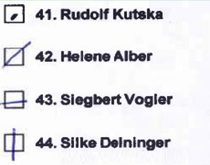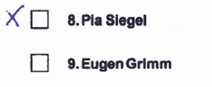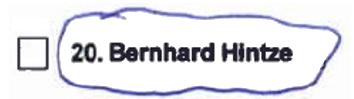

## Sortierung der unklaren Stimmzettel durch den Wahlvorstand {#sortierung-der-unklaren-stimmzettel-durch-den-wahlvorstand}

Alle unklaren Stimmzettel werden durch den Wahlvorstand im Rahmen einer zweiten Sortierung hinsichtlich der weiteren Verarbeitung bewertet und in zwei Klassen eingeteilt.

:::note

**Stimmzettel ist offensichtlich gültig**
- Sofern der eindeutige Wählerwille durch den Wahlvorstand bestätigt wird und der Stimmzettel nicht als ungültig klassifiziert wird, erfolgt auch bei diesen Stimmzetteln eine automatische Verarbeitung, allerdings ist mit einer erweiterten Sichtprüfung im Rahmen des Scanprozesses zu rechnen.
- Jeder Wahlvorschlag eines jeden Stimmzettels wird in diesem Verfahren in einem Sichtprüfungsprozess am Bildschirm durch den Wahlvorstand bewertet.

:::

**Stimmzettel ist ungültig**
- Der Stimmzettel wurde durch den Wahlvorstand eindeutig als ungültig klassifiziert.
- Die Stimmzettel werden ebenfalls gescannt, gehen aber nicht in die Bewertung mit ein. Es wird über den Scanner lediglich die Anzahl der ungültigen Stimmzettel ermittelt und entsprechende Bilder erzeugt.

Für die Vorbereitung zum Scannen sind die folgenden Tätigkeiten auszuführen:

- Die Größe der Scanstapel wird jeweils nach Bedarf gebildet, ca. 50 bis 150 Seiten pro Stapel
- Die offensichtlich gültigen Stimmzettel werden dem Verarbeitungsmodus für gültige Stimmzettel zugeführt und mit Sichtprüfung verarbeitet:
   - (optional) Die Stapel werden nach Wahlbereichen (z.B. farbliche Markierung) sortiert.
   - (optional) Wenn eine Wahlbeteiligung pro Stimmbezirk / Wahllokal erfolgen soll, sind die Stapel entsprechend zu sortieren.
   - Es wird empfohlen im Duplex-Modus zu verarbeiten und leere Seiten zu entfernen. Die Scan-Verarbeitung dauert dadurch länger, die Stapel müssen aber nicht nach Vorderseite sortiert werden.
   - Die Seiten sollten glatt sein, keine geknickten Ecken.
   - Die Verarbeitung erfolgt anschließend durch Einlesen in uniSCAN automatisch. Mögliche Ungereimtheiten werden erkannt und im Sichtprüfungsprozess dem Wahlvorstand am Bildschirm zur Bewertung vorgelegt.
- Die offensichtlich ungültigen Stimmzettel werden dem Verarbeitungsmodus für ungültige Stimmzettel zugeführt und ohne Sichtprüfung verarbeitet:
   - (optional) Die Stapel werden nach Wahlbereichen (z.B. farbliche Markierung) sortiert.
   - (optional) Wenn eine Wahlbeteiligung pro Stimmbezirk / Wahllokal erfolgen soll, sind die Stapel entsprechend zu sortieren.
   - Es wird empfohlen im Duplex-Modus zu verarbeiten und leere Seiten zu entfernen. Die Scan-Verarbeitung dauert dadurch länger, die Stapel müssen aber nicht nach Vorderseite sortiert werden.
   - Die Seiten sollten glatt sein, keine geknickten Ecken.
   - Die Verarbeitung erfolgt anschließend durch Einlesen in uniSCAN automatisch. Mögliche fehlerhafte Zuordnungen werden erkannt und im Sichtprüfungsprozess dem Wahlvorstand am Bildschirm zur Bewertung vorgelegt.

Es kann sein, dass zusätzliches Zahlenmaterial (manuell) erfasst werden muss, z.B. Eingegangene Briefe, leere Wahlbriefe (Stimmzettel vergessen). Dieses Werte sind uniWAHL nachträglich manuell hinzuzufügen.

Es kann sein, dass Stimmzettel während der Verarbeitung reißen, dann versuchen Sie diese mit rückseitigem Klebeband zu reparieren oder erfassen Sie diese manuell in uniWAHL.

## Prozessübersicht {#prozessuebersicht}

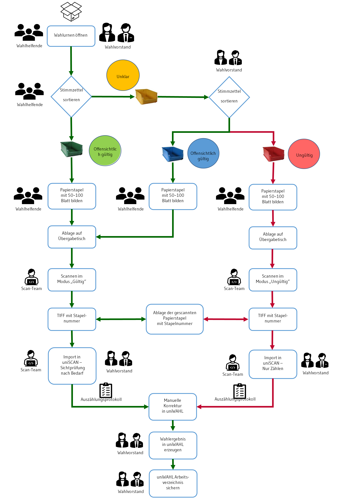

## Übergabetische {#uebergabetische}

Für das Leeren der Urnen, die anschließende Vorsortierung und Übergabe an die Scanstation werden entsprechende Tische (ca. 140 x 70 cm) benötigt. Nachfolgend eine schematische Darstellung:

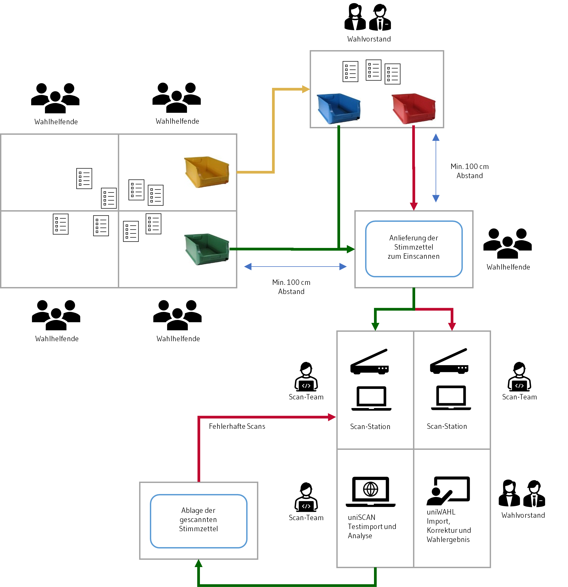

## Scan-Stationen {#scan-stationen}

Die Stapel werden an der Scan-Station eingescannt und in Bilddateien umgewandelt. Die Bilddateien werden zur Auszählung an den TIFF-Ordner von uniSCAN übergeben. Gibt es fragliche Belege (u.a. zu viele Kreuze) werden diese vom Wahlvorstand geprüft und manuell eingegeben. Nach Scan und Freigabe aller fraglichen Stimmzettel kann das vorläufige Wahlergebnis in uniWAHL berechnet werden.

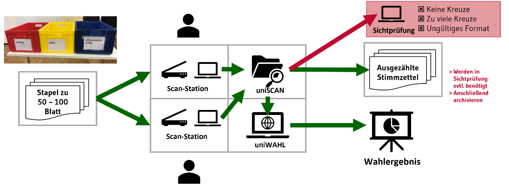

Die Stimmzettel können von mehreren Arbeitsstationen (Laptops) und Einzugsscanner eingelesen werden. Die gescannten Stimmzettel sind der erste Schritt in der uniSCAN-Verarbeitung, es sollte daher auf eine möglichst hohe Qualität geachtet werden. Bitte beachten Sie die o.a. Einstellungen der Scan-Software.

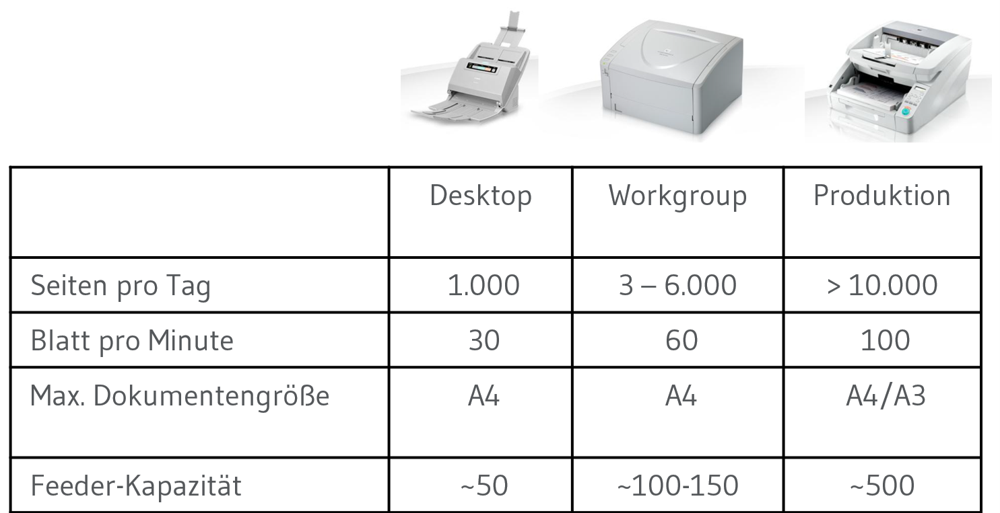
Abb. 4: Typische Größen von Einzugsscanner und deren Verarbeitungskapazität

Es empfiehlt sich unbedingt mehrere Testscans mit der gleichen Scan-Verarbeitung durchzuführen, die auch am Wahltag genutzt werden soll:

- Durchsatz der Scanner (Stimmzettel pro Stunde)
- Mögliche Lesefehler
- Schiefeinzüge
- Schwarze Balken, Striche in den Bilddateien (Reinigen nach Durchsatz)
- Batch-Scannen und Ablage der Tiff-Dateien

## Import und manuelle Sichtprüfung {#import-und-manuelle-sichtpruefung}

Zur Vorbereitung des Imports in uniWAHL sind folgende Schritte auszuführen:

- Um „ungültige“ Zusätze (Handschriftliche Markierungen, Stempel) zu erkennen, müssen rechtzeitig vor der Wahl sogenannte „Referenzstimmzettel“ in uniSCAN hinterlegt werden. (Leere Stimmzettel, die den Unterschied der Schwarzabdeckung verdeutlichen) – 1 Stapel pro Stimmzettel leer einscannen und in uniWAHL hinterlegen.
- Die Tiff-Dateien werden von der Scan-Station oder manuell nach „gültig / ungültig …“, nach „Stapel / Urne o.ä.“ benannt, da so später eine leichtere Zuordnung zu den Papierstapeln erreicht werden kann (nachträgliches Heraussuchen eines in der Sichtprüfung auffälligen Stimmzettels in Papierform) und ggf. nach „WHL / Wahlbereich“, wenn mehrere uniWAHL-Wahlprojekte (WHL) beim Import genutzt werden müssen.
- (optional) Zusammenführen der gescannten Tiff-Dateien in IrfanView oder einer vergleichbaren Software (Multipage-Tiff) reduziert die Anzahl zu verarbeitender Stapel und Auszählungsprotokolle und erhöht somit die Übersicht des Wahlvorstands während des uniSCAN Imports.
- Da die Tiff-Dateien von mehreren Scan-Arbeitsstationen in einen Scan-Eingang gescannt und anschließend zusammengeführt werden, empfiehlt sich die uniSCAN-Betriebsart „**Online-Modus mit Sofort starten**“, wenn die Dateien aus dem Scan-Eingang in den Tiff-Ordner […**/uniscan/tiff**] verschoben werden.

Der Import der Dateien (siehe oben) über den [..**/uniscan/tiff**]-Ordner erfolgt getrennt nach den oben beschriebenen Verarbeitungen (gültig / ungültig).

Während der Verarbeitung werden die uniSCAN-Einstellungen vor dem Import an die jeweiligen Scan-Dateien angepasst:

- Unerlaubte Zusätze suchen (Warnungen ausgeben)
- Markierungen durch Schwärzung löschen (Korrekturen zulassen ja/nein)
- Schwellwerte der Schwarzabdeckung (&lt;3-6% leer, &lt;10-15% Sichtprüfung, &gt;80-90% Korrektur, wenn akiviert)
- Wenn im Debug-Modus verarbeitet wird, werden alle Stimmzettel als Einzeldateien im Ordner […**/uniscan/debug**] mit Erkennungsmarken und Schwellwerten abgelegt
- Keine Seitenkorrektur, kein Entrauschen (Nur bei Scanproblemen)

Nach der Verarbeitung werden die Tiff-Dateien automatisch in […**/uniscan/archive**] abgelegt.

Die manuelle Verifikation wird anhand der Auszählungsprotokolle in HTML durchgeführt. Diese können mit handschriftlichen Ergänzungen versehen werden, um die manuellen Änderungen nachtäglich zu belegen.

Es sollten folgende Warnungen und Fehler unbedingt behandelt werden:

- **NonForms** (nicht erkannte Formulare) – Leere Rückseiten, Barcode zerstört, Seite verdreht - Diese müssen erneut gescannt oder manuell in uniWAHL eingegeben werden, wenn lesbar
- **Alle Warnungen – z.B. Unerlaubte Zusätze in Gültige gefunden** – Handschriftliche Anmerkung wurde übersehen – Stimmzettel manuell als „Ungültig“ erfassen, „Gültige“ verringern / „Ungültige“ im Wahlbereich erhöhen
- **Fehlerhaft als gültig erkannter Stimmzettel**, obwohl dieser als „ungültig“ vorsortiert war – z.B. rein technisch gültiger Stimmzettel aus Briefwahl aber ohne Wahlschein - Stimmen in uniWAHL manuell entfernen, „Gültige“ verringern / „Ungültige“ erhöhen
- **Fehlerhaft als ungültig erkannter Stimmzettel** – z.B. Kreuzung zu schwach oder Kreuzung durch mehrere Kästchen - Stimmen in uniWAHL manuell ergänzen, „Gültige“ erhöhen / „Ungültige“ verringern
- **Fehlerhaft markierte Kästchen** durch Falzen, Farbreste bei dunklem Papier und Verunreinigung der Scan-Leiste - Diese müssen eventuell erneut gescannt werden

## Anlage - Merkblatt zur Vorsortierung für Wahlhelfende {#anlage-merkblatt-zur-vorsortierung-fuer-wahlhelfende}

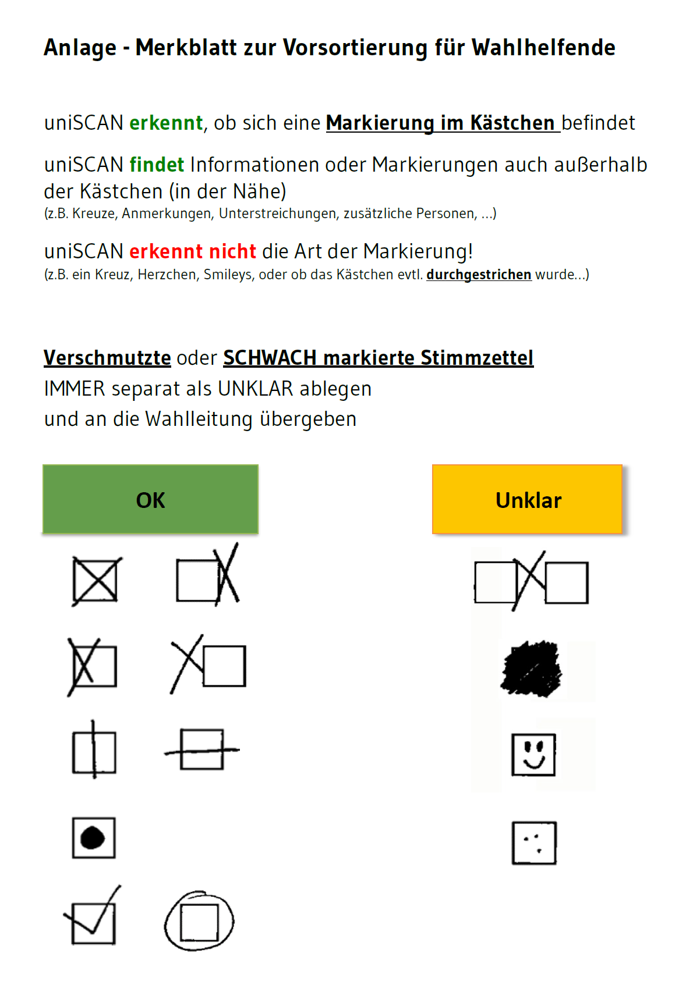
