Im diesem Abschnitt wird die Vorbereitung und der Test einer Online-Wahl unter Nutzung des Add-on OWS vorgestellt.

----

#### Übersicht über das Verfahren {#uebersicht-ueber-das-verfahren}

1. Die Vorbereitung einer Online-Wahl wird direkt in uniWAHL durchgeführt. Analog zur Wahl mit Papierstimmzetteln werden die benötigen Informationen (Personendaten, Wahlverfahren, Stimmenzahl etc.) zunächst in uniWAHL hinterlegt:
   1. Konfiguration der [Wahlordnung](../handbuch/4_vorbereitung/4-2_wahlordnung.md)
   1. Spezifizieren der [Gremien und Gruppen](./2_gremium.md)
   1. Hinterlegen der [Wählergruppenkodierung](../handbuch/10_ows/10-4_waehler_innengruppen.md) in den Gruppen / Wahlbereichen.
   1. [Texte](../handbuch/7_wahldokumente/7-3_textbausteine.md) der Stimmzettel und [Layout](../handbuch/7_wahldokumente/7-4_layout.md) des Online-Wahlsystems festlegen
   1. Eingabe der [Wahlvorschlagslisten und der Kandidierenden](./4_wahlvorschlaege.md)
   1. Übergabe der Daten per [Dateitransfer](https://dateitransfer.wahlen-organisieren.de/) an das Online-Wahlsystem 
1. Zur Erzeugung einer echten Wahl im Online-Wahlsystem werden Dateien aus uniWAHL exportiert und im Online-Wahlsystem hochgeladen:
   1. Die **Wahlprojekt-Datei** aus der uniWAHL-Kernsoftware (im WHL- oder JSON-Format) mit allen Statusgruppen / Wahlbereichen im Status "Kandidateneingabe fertig" (dunkelblau), die gewählt werden sollen. (siehe auch [OWS Datenexport](../handbuch/10_ows/10-3_export.md))
   1. **Ein Wahlverzeichnis** (Testwähler:innen oder Live-Wähler:innen) mit 2 Spalten:
      1. **1. Spalte**: z.B. E-Mail, userID bzw. PseudoID: gibt die Identifikation des Wählenden aus dem Identity Management wieder.
      1. **2. Spalte**: Wählergruppe bzw. Wahlberechtigung: gibt die [Wählergruppencodes](../handbuch/10_ows/10-4_waehler_innengruppen.md) zur Zuordnung der Stimmzettel an.
   1. Das Logo, das in der Wahlkabine genutzt werden soll (URL zu einer Logo-Bilddatei (JPG,PNG,SVG) im Format 200x90 Pixel). 
1. Die Rohdaten werden nach der Wahldurchführung aus dem Online-Wahlsystem exportiert und in uniWAHL importiert:
   1. Mit dem Menübefehl `OWS / Importiere Rohdaten` werden die Stimmzettel-Rohdaten aus dem Online-Wahlsystem eingelesen.
   1. Beim Import wird die [Wahlkennung](../handbuch/8_funktionen/8-3_wahlkennung.md) der Import-Datei geprüft, damit der Import dem korrekten Wahlprojekt zugeordnet wird.
   1. Anschließend wird automatisiert ein vollständiges [Auszählungsprotokoll](../handbuch/10_ows/10-5_import.md) erstellt, in dem alle Stimmzettel protokolliert sind und das Stimmverhalten der Wählenden sichtbar wird.
   1. Die Stimmen werden den Kandidierenden im Fenster: Zählen und Auswerten zugeordnet. 
1. Es kann nun die [Auszählung](./8_auszaehlen.md) fertig gesetzt werden, die Sitzverteilung wird gestartet und das Wahlergebnis wird erstellt.

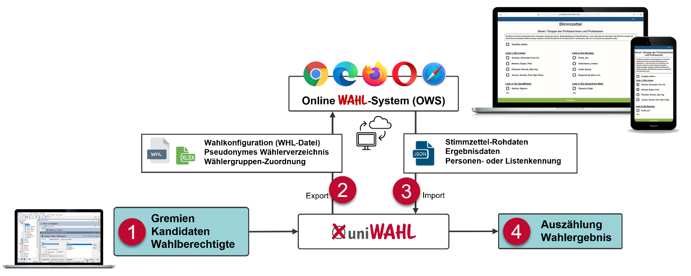

----

## Erster Test - Live-Vorschau {#erster-test-live-vorschau}

Zur Erzeugung einer Live-Vorschau am Preview-Server wird kein Dateitransfer benötigt, allerdings wird hier eine reine Vorschau der Wahlkabine ohne echte Wahl (keine Stimmabgabe - damit auch kein Wahlergebnis, keine Wählergruppen - alle Stimmzettel sind sichtbar) erzeugt. Die Preview öffnet sich direkt im Browser.

- Starten Sie uniWAHL. Öffnen Sie die **DemoWahl.whl** (...\whl\beispiele).
- Klicken Sie die Schaltfläche 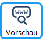 in der Symbolleiste oben rechts, um die Online-Vorschau zu öffnen.
- Testen Sie zuerst, ob die Vorschau korrekt geöffnet wird (Zur Anzeige muss mindestens 1 Wahlbereich im Status 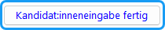 (dunkelblau sein).
- Die hier dargestellte Wahlkabine entspricht 1:1 der Wahlkonfiguration, die später im Online-Wahlsystem hochgeladen wird. Machen Sie sich mit dem Wahlablauf und den Elementen der Wahlkabine vertraut.

Sie werden feststellen, dass keine Authentifizierung zur Live-Vorschau notwendig ist und immer alle Stimmzettel angezeigt werden (Sicht der Wahlorganisation). Die Sicht der Wahlberechtigten gehen wir mit Ihnen in den Testwahlen durch, so dass Sie das "echte" Wählen testen können.

:::warning

**Hinweis:** Sollte keine Live-Preview angezeigt werden können, besteht in den meisten Fällen ein Netzwerkproblem bzw. eine Restriktion innerhalb der hauseigenen Firewall. Wir bitten Sie in diesem Fall, Ihre IT-Administration zu kontaktieren und eine explizite Freigabe für den Live-Preview-Server unter "preview.gremienwahlen.de" einzurichten.

:::

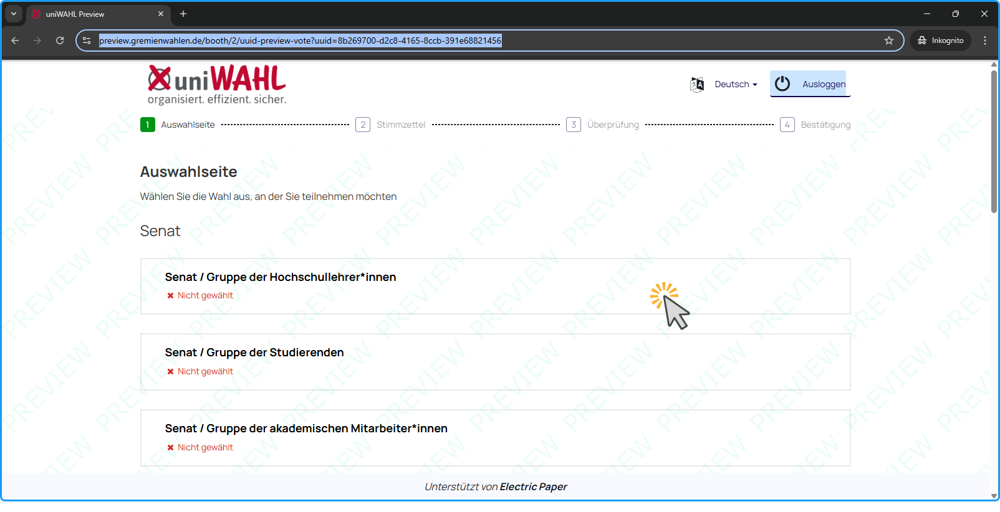

## Layout der Online-Wahlkabine anpassen {#layout-der-online-wahlkabine-anpassen}

Das Layout der Online-Wahlkabine im uniWAHL Online-Wahlsystem (OWS) kann im allgemeinen oder gruppenspezifischen [Layout](../handbuch/7_wahldokumente/7-4_layout.md) angepasst werden. Die Einstellungen sind in der Live-Vorschau sofort sichtbar und werden später per JSON-Datei an das Online-Wahlsystem übergeben.

### Logo-Grafik {#logo-grafik}

- Öffnen Sie die Einstellungen in `Konfiguration/Layout der Dokumente`.
- Hinterlegen Sie in `Stimmzettel/Logo-Grafik` eine Bild-URL zum Logo, das in der Wahlkabine angezeigt werden soll, z.B. "https://download.electricpaper.de/uniWAHL/Demo/uniWAHL.png" (Der Link *muss* öffentlich erreichbar sein und über HTTPS angesprochen werden.). Kopieren Sie den Link zu Ihrem Logo z.B. von Ihrer Website über die Funktion 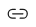 **Link kopieren** im Kontextmenü des Webbrowsers.
- Klicken Sie `Speichern`.
- Klicken Sie die Schaltfläche  in der Symbolleiste oben rechts, um zu sehen, ob das Logo korrekt angezeigt wird.
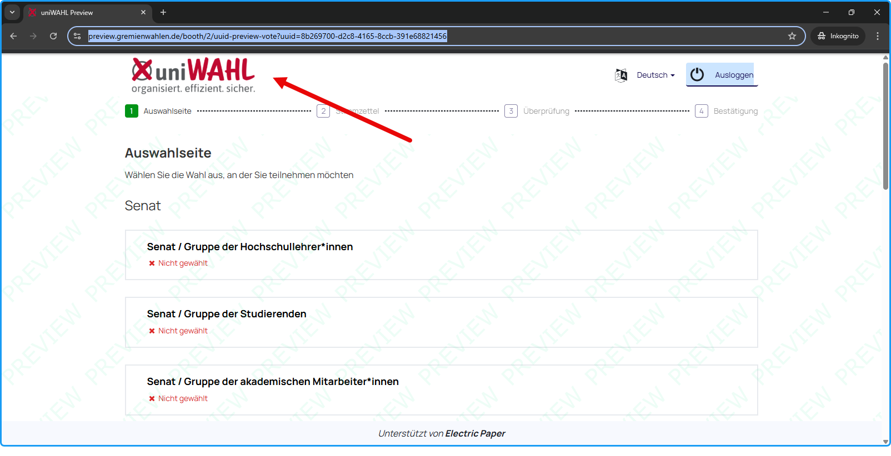

### Kandidat:innen-Felder {#kandidat-innen-felder}

Es gilt vorab zu klären, welche Angaben zu den Kandidierenden auf dem Stimmzettel der Online-Wahlkabine dargestellt werden sollen, wenn die Wahlordnung keinen Aufschluss dazu gibt. Die Kandidierenden-Felder werden auf der Registerkarte `Stimmzettel` des Layouts eingestellt und gelten gleichermaßen für Papier- wir auch Online-Stimmzettel.

- Öffnen Sie die Einstellungen in `Konfiguration/Layout der Dokumente`.
- Erhöhen Sie in `Stimmzettel/Kandidat:innenfelder` die Anzahl der Felder im Dropdown auf **3**.
- Wählen Sie **Bereich** als drittes Feld aus (Dropdown).
- Aktivieren Sie die Funktion `als Tabelle`.
- Klicken Sie `Speichern`.
- Klicken Sie die Schaltfläche  in der Symbolleiste oben rechts, um zu sehen, wie der Stimmzettel dargestellt wird.

:::tip

Sie werden feststellen, dass wenn die Option **als Tabelle** aktiviert ist, die Kandidierenden-Felder ab dem dritten Feld unterhalb in kleiner Schrift dargestellt werden. 
Sollten Sie die Kandidierenden in einem anderen Format z.B. "Vorname Nachname" oder "Titel Nachname, Vorname" darstellen wollen, nutzen Sie bitte die Möglichkeiten der [Kandidaten-Felder](../handbuch/7_wahldokumente/7-4_layout.md#kandidaten-felder).

:::

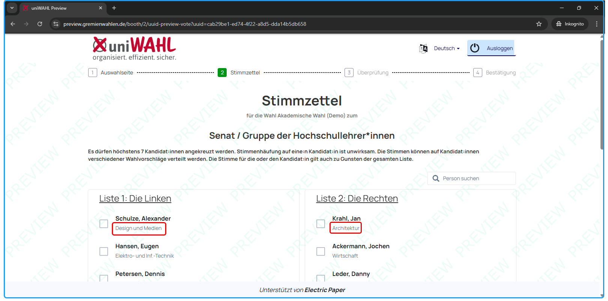

### Elemente der Wahlkabine {#elemente-der-wahlkabine}

Wenn Sie sich in Teil 1 bereits mit Online-Wahlkabine vertraut gemacht haben, sind Ihnen evtl. bereits Elemente aufgefallen, die Sie als erklärungsbedürftig oder nicht notwendig erachten. Nahezu alle Elemente der Online-Wahlkabine lassen sich ein-/ausblenden. Dies kann über die Live-Vorschau getestet werden.

- Öffnen Sie die Einstellungen in `Konfiguration/Layout der Dokumente`.
- De-/aktivieren Sie folgende Optionen im Register `Online-Wahl` :
   1. **QR Code ausblenden** (Abschlussseite - dient der direkten Verifikation der Stimmabgabe an einem zweiten Endgerät)
   1. **Stimmzettelverfolgung ausblenden** (Hash-Code des Stimmzettels auf Abschlussseite - dient der Verifikation der Stimmabgabe am selben Endgerät)
   1. **Stimmabgabeschein (Nachweis PDF) ausblenden** (Button "Drucken" auf der Abschlussseite - dient der nachträglichen Verifikation der Stimmabgabe)
   1. **Stimmzettel Hashwert und Stimmabgabeprüfung ausblenden** (Die sog. Benaloh-Challenge - eine kryptografische Technik zur Sicherstellung der Ehrlichkeit eines zunächst nicht vertrauenswürdigen Geräts)
- Testen Sie verschiedene Elemente und schauen Sie sich anschließend die Kabine in der Live-Vorschau an.

|  |  |
|---|---|
|  | Diese Schaltfläche im Register `Online-Wahl` ermöglicht es, die Live-Vorschau direkt im Layout zu aktivieren und so die Layoutoptionen schneller zu testen / hinterlegen. |

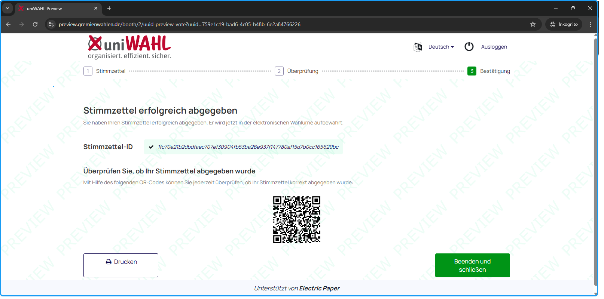

### Stimmzettel Spalten-Layout {#stimmzettel-spalten-layout}

Je nach Anzahl der eingegangenen Wahlvorschläge kann es sinnvoll sein, das Spaltenlayout der Online-Wahlkabine zu ändern, um z.B. 3 Listen gleichwertig nebeneinander darzustellen (bis zu 4 Spalten sind im Online-Layout möglich).
- Öffnen Sie die Einstellungen in `Konfiguration/Layout der Dokumente`.
- Ändern Sie die **Anzahl Spalten** im Register `Online-Wahl` je nachdem, ob eine Listenwahl oder Mehrheitswahl vorliegt.
- Testen Sie verschiedene Spaltenlayouts und schauen Sie sich anschließend die Kabine in der Live-Vorschau an.

|  |  |
|---|---|
| 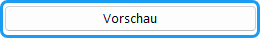 | Diese Schaltfläche im Register `Online-Wahl` ermöglicht es, die Live-Vorschau direkt im Layout zu aktivieren und so die Layoutoptionen schneller zu testen / hinterlegen. |

:::warning

Es empfiehlt sich Spaltenlayouts nur in Einzelfällen direkt in den [gruppenindividuellen Layouts](../handbuch/7_wahldokumente/7-4_layout.md) der Wahlbereiche erst dann zu ändern, wenn alle Wahlvorschläge bzw. Kandidierenden im jeweiligen Wahlbereich eingegeben wurden.

:::

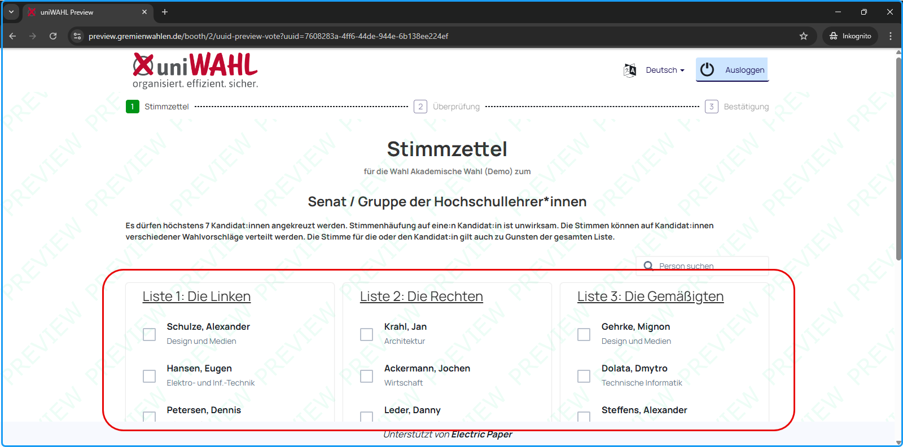

### Farben {#farben}

Die Wahlkabine beinhaltet ein Kopfleisten-Element, das individuell eingefärbt werden kann und Schaltflächen bzw. Navigationselemente. Weitere Farbanpassungen können mittels [Stimmzettel-Farbe](../handbuch/7_wahldokumente/7-4_layout.md#stimmzettel-farbe) oder unter Zuhilfenahme benutzerdefinierten CSS anpassen.
- Öffnen Sie die Einstellungen in `Konfiguration/Layout der Dokumente`.
- Ändern Sie die **Kopfleiste Hintergrundfarbe**(1) im Register `Online-Wahl` z.B. in den Farbcode **#f5f9fd**.
- Ändern Sie die **Schaltfläche "Gehe zum nächsten Stimmzettel"**(2) im Register `Online-Wahl` z.B. in den Farbcode **#c10230**.
- Schauen Sie sich anschließend die Kabine in der Live-Vorschau an.

:::tip

**Tipp:** Sollten Sie bestimmte Farb- oder Formatierungsänderungen wünschen, die aktuell nicht in der uniWAHL-Konfiguration enthalten sind, sprechen Sie gern unseren [Support](https://wahlen-organisieren.de/leistungen/support/) an, um Sie bei der Erstellung des benutzerdefinierten CSS zu unterstützen.

:::

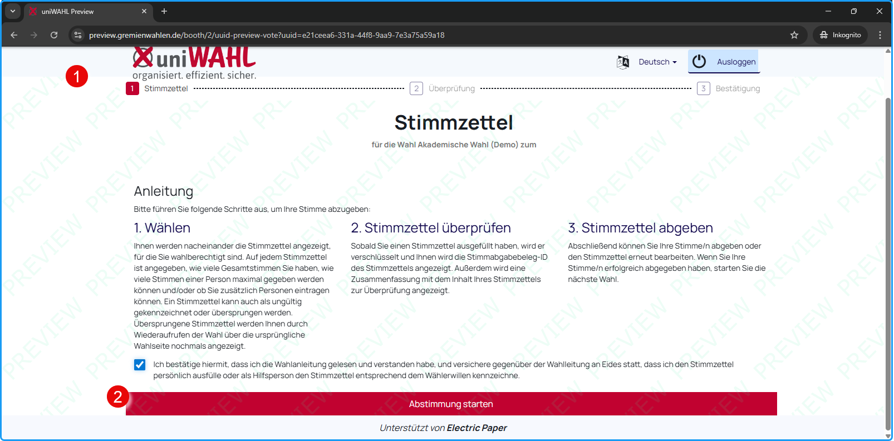

## Textanpassungen {#textanpassungen}

Die Texte der Online-Wahlkabine unterscheiden sich in [Bestimmungstexte der Stimmzettel](../handbuch/7_wahldokumente/7-3_textbausteine.md#texte-der-stimmzettel) (**die oberhalb der Stimmzettel aufgeführt sind**) und allgemeine [Texte der Online-Wahlkabine](../handbuch/7_wahldokumente/7-3_textbausteine.md#texte-zur-online-wahl) (**Anleitung, Schaltflächen etc.**). Alle Texte lassen sich direkt in uniWAHL ändern und mit einer Live-Vorschau testen.

### Texte der Online-Wahlkabine {#texte-der-online-wahlkabine}

- Öffnen Sie die Einstellungen in `Konfiguration/Textbausteine`.
- Wechseln Sie auf die Registerkarte `Online-Wahlsystem`.
- Öffnen Sie sich zunächst die Kabine in der Live-Vorschau durch Klick auf die Schaltfläche.

|  |  |
|---|---|
|  | Diese Schaltfläche im Register `Online-Wahlsystem` ermöglicht es, die Live-Vorschau direkt in den Textbausteinen zu aktivieren und so geänderte Texte schneller zu hinterlegen bzw. direkt zu testen. |

- Markieren Sie einen Text in der Live-Vorschau der Kabine, z.B. den Text "Auswahlseite" und kopieren Sie diesen in die Zwischenablage (STRG+C).
- Wechseln Sie zurück auf die Registerkarte `Online-Wahlsystem` in uniWAHL.
- Fügen Sie den Text in das **Suchfeld** oberhalb der Texte ein (STRG+V) und führen Sie die Suche mit ENTER aus. Es werden Ihnen nun alle Texte angezeigt, die das Wort "Anleitung" enthalten.
- Ändern Sie den Text nach Ihren Wünschen z.B. in "Gremienwahlen" oder "Inhaltverzeichnis" ab.
- Schauen Sie sich anschließend die Kabine in der Live-Vorschau an, um die Textänderung anzuzeigen.

:::tip

**Tipp:** Sie werden feststellen, dass bestimmte Begrifflichkeiten in mehreren Textbausteinen vorkommen. Es empfiehlt sich daher längere Textpassagen zu kopieren, um den richtigen Text schneller zu finden. Die Texte werden mit einer Highlight-Farbe hinterlegt, zudem sind die Bezeichner (im o.a. Beispiel "avbooth.electionChooserScreen.title") angegeben, um die Textstelle besser unterscheidbar zu machen.

:::

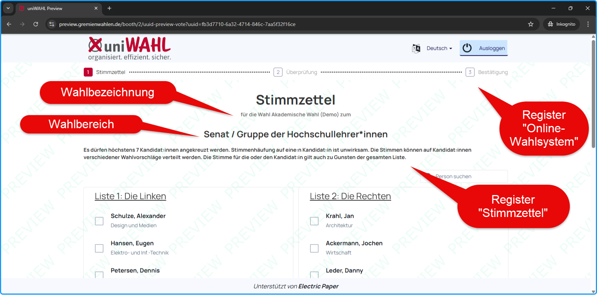

### Mehrsprachige Texte {#mehrsprachige-texte}

Alle Texte der Online-Wahlkabine können in verschiedenen Sprachen dargestellt werden. Wenn die Mehrsprachigkeit in der [Wahlordnung](../handbuch/4_vorbereitung/4-2_wahlordnung.md) aktiviert ist, werden Übersetzungsfelder im Wahlprojekt, den Gremien und Wahlbereichen sowie in den Textbausteinen angeboten.

- Öffnen Sie die Einstellungen der Wahlordnung in `Konfiguration/Wahlordnung`.
- Aktivieren Sie auf der Registerkarte `Allgemein` eine weitere Sprache durch Mehrfachauswahl (STRG+Klick oder UMSCHALT+Klick).
- Öffnen Sie das Wahlprojekt durch Doppelklick im Navigationsfeld und Hinterlegen eine Übersetzung in [**Name der Institution**] und `Wahlbezeichnung`.
- Öffnen Sie ein Gremium durch Doppelklick im Navigationsfeld und Hinterlegen eine Übersetzung in [**Name**].
- Öffnen Sie einen Wahlbereich durch Doppelklick im Navigationsfeld und Hinterlegen eine Übersetzung in [**Name**].
- Jetzt öffnen Sie die `Konfiguration/Textbausteine`. Sie werden feststellen, dass neben den deutschen Texten bereits Übersetzungen für Standardtexte hinterlegt sind.
- Öffnen Sie nun die Live-Vorschau in den Textbausteinen.

|  |  |
|---|---|
| 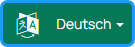 | Die Schaltfläche zur Sprachauswahl in der Online-Kabine zeigt an, dass mehrere Sprachen zur Verfügung stehen. Ist die Mehrsprachigkeit in der Wahlordnung deaktiviert, wird die Schaltfläche nicht angezeigt. |

:::warning

**Hinweis:** Listennamen und Namen von Kandidierenden werden aktuell nicht übersetzt. Wenn Sie die Mehrsprachigkeit aktivieren, müssen Sie auch alle oben beschriebenen Felder auffüllen (Wahlprojekt, Gremien, Wahlbereiche, Textbausteine), andernfalls sind die Texte in den Übersetzungen leer. Wir empfehlen Ihnen, beim Test einen kompletten Wahldurchgang in alle Sprachsets durchzuführen.

:::

:::tip

**Tipp:** Es ist möglich, weitere Sprachsets im Online-Wahlsystem zu hinterlegen. Sollten Sie eine weitere Sprache für Ihre Wahl benötigen, sprechen Sie gern unseren [Support](https://wahlen-organisieren.de/leistungen/support/) an. 
In `Konfiguration / Layout der Dokumente / Online-Wahl` kann eine `Standardsprache` erzwungen werden. Wird diese Option deaktiviert, orientiert sich die initiale Sprache am Browser bzw. der letzten Sprachauswahl.

:::

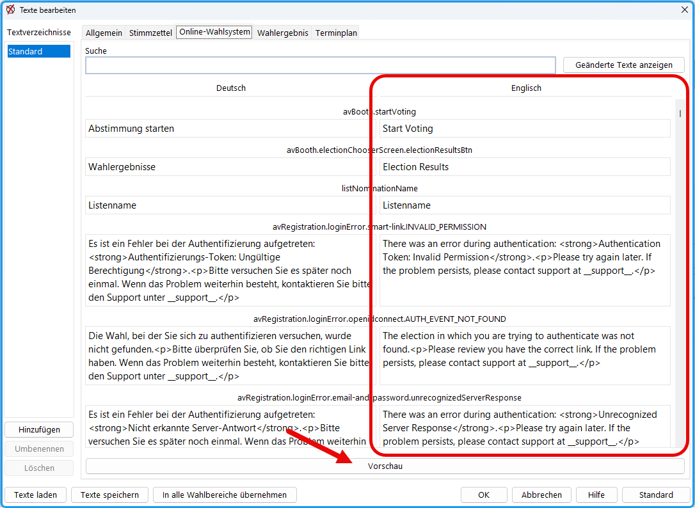

## Wählergruppen {#waehlergruppen}

uniWAHL unterstützt die automatisierte Übertragung der Stimmzettel-Daten, Konfigurationen und (pseudonymen) Wahlverzeichnissen in das uniWAHL Online-Wahlsystem. Es müssen dazu in uniWAHL:
1. Im Wahlverzeichnis wichtige Merkmale zur Wahlberechtigung ausgewählt werden, die über die Zuordnung der Stimmzettel entscheiden.
1. Bei jedem Wahlbereich / jeder Statusgruppe diese Merkmale hinterlegt werden, damit die Stimmzettel passend erstellt zugeordnet werden können.

### Zuordnung der Wählergruppen zu den Personen {#zuordnung-der-waehlergruppen-zu-den-personen}

Es wird hierfür ein (pseudonymes) Wahlverzeichnis (XLSX) benötigt. Jede Person ist eine Zeile in diesem Verzeichnis und gehört mindestens zu einer Wählergruppe, z.B. Studierende in Fakultät 3. Durch den Menübefehl „Wählergruppen kodieren“ wird ein Assistent aufgerufen, der jeder Person im Wahlverzeichnis den Code ihrer Wählergruppe zuordnet (Eine neue Spalte mit kommaseparierten Werten zur Wahlberechtigung wird hinzugefügt).

- Öffnen Sie das Menü `OWS/Wahlverzeichnis kodieren`. Es wird ein Assistent aufgerufen, der jeder Person im Wählerverzeichnis den Code ihrer Wählergruppe zuordnet (Eine neue Spalte mit kommaseparierten Werten zur Wahlberechtigung wird in der XSLX hinzugefügt).
- **1. Schritt:** Wählen Sie unter `Dateiname` das Wahlverzeichnis aus. Sie können die Beispiel-Datei (C:\Users\&lt;Nutzername&gt;\uniwahl\waehler\Wahlverzeichnis-Hochschule.xlsx) benutzen, um das Ganze auszuprobieren.
- Klicken Sie `Weiter` .
- **2. Schritt:** Wählen Sie die Spalten aus, die für die Codierung benutzt werden sollen (z.B. Bereich, Statusgruppe), indem Sie diese der Reihe nach doppelklicken oder `Auswählen` . Sie werden dadurch in die rechte Liste übernommen.
- Klicken Sie `Weiter` .
- **3. Schritt:** In der Liste erscheinen die ausgewählten Bezeichner. Durch Doppelklick auf den jeweiligen mit „*“-markierten Bezeichner öffnet sich ein Dialog, in dem man den in der Datei in dieser Spalte gefundenen Einträgen beliebige Codes zuweisen kann. Diese können aus Buchstaben oder Ziffern bestehen. **Kodieren Sie alle Attribute, die mit * markiert sind.**
- Klicken Sie `Weiter` .

Es wird eine neue Excel-Tabelle erzeugt, in die die Wählergruppen-Codes als zusätzliche Spalte eingetragen wurden. Die ursprüngliche Datei bleibt unverändert. Später können Sie in dieser neuen Tabelle die persönlichen Daten der Personen durch die pseudonyme Personenkennung ersetzen und diese Tabelle direkt an das Online-Wahlsystem übergeben.

:::warning

**Achtung:** **Personen ohne Eintrag in der Wählergruppe werden später ALLE Stimmzettel angezeigt.**

Zur Übergabe an das Online-Wahlsystem werden die Spalten „PseudoID“ und „Wählergruppe“ benötigt. Als PseudoID kann auch eine Wähler-ID oder Laufnummer bzw. (pseudonyme) E-Mail-Adresse genutzt werden, wenn zugleich ein Versand der Einladungen aus dem Online-Wahlsystem erfolgen soll.

:::

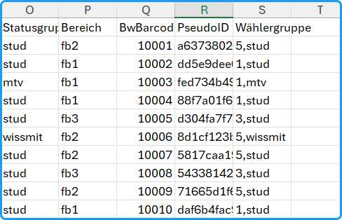

### Eingabe der Wähler:innengruppen der Stimmzettel {#eingabe-der-waehler-innengruppen-der-stimmzettel}

Im Dialogfenster jeder Statusgruppe/jedes Wahlbereichs befindet sich ein Eingabefeld `Wählergruppe`, in das die für den Stimmzettel dieses Wahlbereichs zugeordnete Wählergruppe eingetragen werden muss. Die Wählergruppen-Codes werden durch Komma getrennt (***kein Leerzeichen!***).

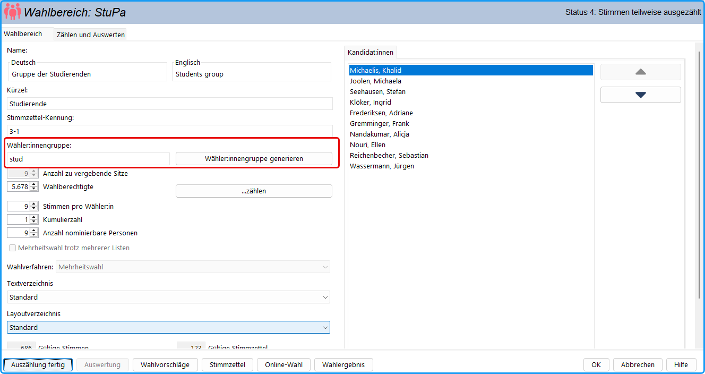
Dieser Stimmzettel wird allen Studierenden der Fakultät VII angeboten.
Mit Hilfe der Schaltfläche `Wählergruppe generieren` kann die Wähler:innengruppe automatisch aus dem **Kürzel des Gremium + Komma + Kürzel der Gruppe** / des Wahlbereichs zusammengesetzt werden. In vielen Fällen erleichtert dies die Erzeugung der Wählergruppen, da dies der Hierarchie der Stimmzettel entspricht.

:::warning

**Hinweis:** Bitte beachten Sie, dass die in den Gruppe / den Wahlbereichen hinterlegten Codes unter allen Umständen den Codes des Wahlverzeichnis (siehe obige Abbildung) entsprechen müssen, da es sonst zu fehlerhaften Zuordnungen im Online-Wahlsystem kommt.

:::

### Kontrolle und Korrektur der Zuordnungen {#kontrolle-und-korrektur-der-zuordnungen}

Mit dem Menü-Befehl `Wählergruppen kontrollieren` *muss* die Zuordnung der Stimmzettel zu den Wählergruppen aus zwei verschiedenen Blickwinkeln überprüft werden, um sicherzustellen, dass alle Zuordnungen korrekt vorgenommen wurden.

- Öffnen Sie den Dialog in `OWS / Wählergruppen kontrollieren` .
- Überprüfen Sie alle **Merkmale der Wahlberechtigten**, mindestens die, die LEER, GELB oder ROT sind.
- Überprüfen und korrigieren Sie die Einträge durch Klick in die Spalte und direkte Eingabe.
- Bestätigen Sie Ihre Eingaben mit `OK` .

:::warning

**Hinweise:**
- **Leere** Wählergruppen werden ***allen*** Wahlberechtigten angezeigt. Es kann Fälle geben (z.B. „Kleine Wahlen“), in denen allen Wähler:innen ein bestimmter Stimmzettel angezeigt werden soll. In den Fällen, in denen die Wählergruppe schlichtweg vergessen wurde, hilft die gelbe Markierung.
- **Doppelte** Wählergruppen besagen, dass einer bestimmten Wählergruppe mehrere Stimmzettel angezeigt werden. Es kann Fälle geben (z.B. parallele Wahl mehrerer Gremien), in denen diese Zuordnung sinnvoll ist. In den Fällen, in denen der Code versehentlich gedoppelt wurden, hilft die gelbe Markierung.
- Um Stimmzettel mit **mehreren Merkmalen** (z.B. „Stud,7“) zu erhalten, muss die Person im Wahlverzeichnis mit **allen** Codes versehen werden.
- Die Merkmale der Stimmzettel in uniWAHL sind also eine **Teilmenge aller Codes der Person im Wahlverzeichnis**. In oberen Beispiel würde eine Person, die im Wahlverzeichnis mit „Stud,7,weiblich“ kodiert ist, die Stimmzettel „Senat/Stud“, „StuPa“, „FakR IIV / Studierende“ und auch leere Stimmzettel („FakR IIV / WissMit“ und „FakR IlV / MTV“) angezeigt bekommen.

:::

Abschließend wird eine Excel-Tabelle ausgegeben, hiermit können Sie die Zuordnungen aus zwei verschiedenen Perspektiven mit dem Wahlverzeichnis abgleichen:
1. Welche Wählergruppen sind in den Stimmzetteln hinterlegt?
1. Welche Personen bekommen welche Stimmzettel?

:::tip

**Tipp:** Diese Excel-Tabelle können Sie auch Ihren IT-Verantwortlichen zur Verfügung stellen, die die Codes in den Quellsystemen des Wahlverzeichnis hinterlegen, so dass die Kodierung dieser Systeme an die uniWAHL-Konfiguration angepasst werden kann oder andersherum.

:::

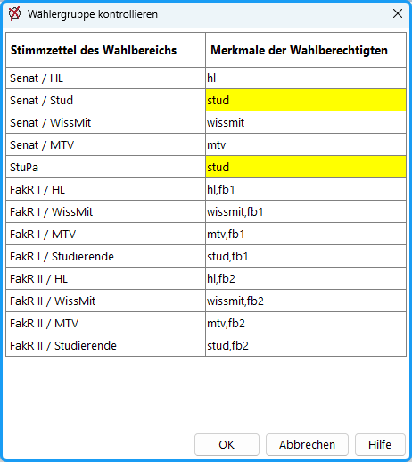

## Erzeugung der Online-Wahlfunktionen (JSON) {#erzeugung-der-online-wahlfunktionen-json}

Bei der Erzeugung der Übergabe-Dateien und Anlage im Online-Wahlsystem unterstützen Sie unsere Online-Wahlmanager bzw. unser [Support](https://wahlen-organisieren.de/leistungen/support/).

Aktuell stehen **3 Übergabe-Modi** zur Verfügung:

Menü: `OWS / Wahlverzeichnis-Prüfung`
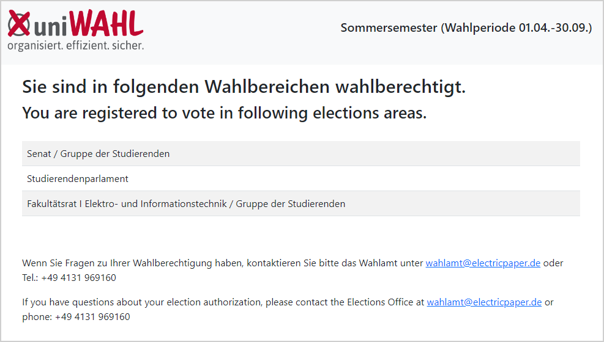
Das Wahlberechtigtenverzeichnis dient als Grundlage für die Organisation und Durchführung von Online-Wahlen, da es sicherstellt, dass nur diejenigen wählen können, die die gesetzten Anforderungen erfüllen. Über den Service uniWAHL OWS-Verzeichnisprüfung kann jede Person – online den Eintrag zur Wahlberechtigung im Verzeichnis überprüfen.

Menü: `OWS / Nominierung erzeugen`
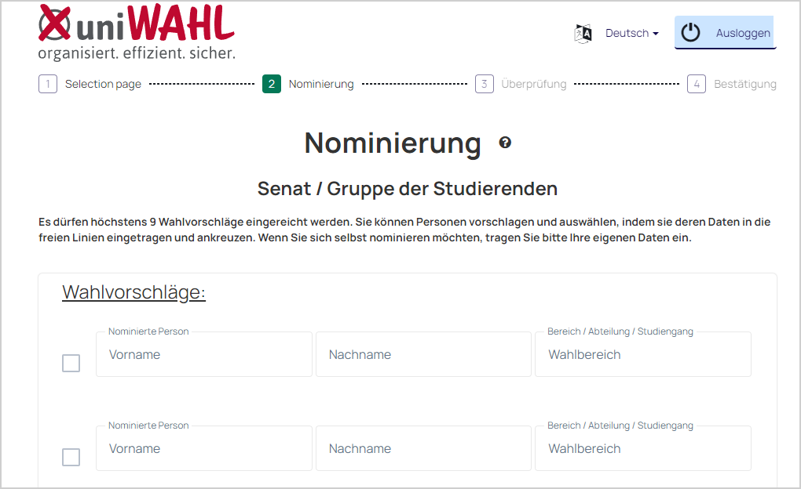
Die  Funktion  „Nominierung  erzeugen“  ermöglicht  es,  einfache  Wahlvorschlagslisten direkt über das Online-Wahlsystem einzureichen. Es können neben Kandidaten- auch Listenwahlvorschläge erfasst und anschließend direkt in uniWAHL importiert werden.

Menü: `OWS / Stimmzettel im JSON-Format erzeugen`
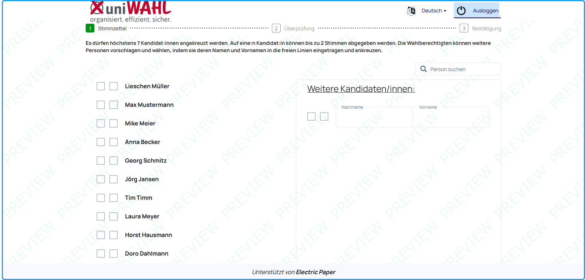
Diese Funktion übergibt die Stimmzettel an das Online-Wahlsystem (siehe [JSON-Export](../handbuch/10_ows/10-3_export.md)).

Zur Übergabe an das Online-Wahlsystem werden die jedem Stimmzettel zugewiesenen Wählergruppen mit den Stimmzettel-Daten übergeben (siehe [Wähler:innengruppe](../handbuch/10_ows/10-4_waehler_innengruppen.md)).

## Import der Rohdaten {#import-der-rohdaten}

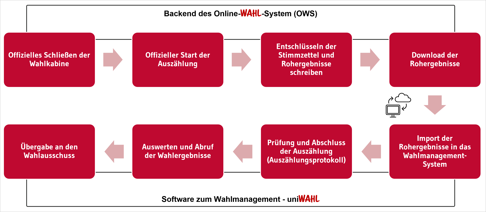
Nachdem alle Daten im Online-Wahlsystem hochgeladen wurden, wird die Stimmabgabe mit Unterstützung unserer Online-Wahlmanager durchgeführt. Die Wahl wird im Backend des Online-Wahlsystems erzeugt, automatisiert gestartet und gestoppt. Nach der Beendigung des Wahlzeitraums kann nun die Auszählung erfolgen.

- Öffnen Sie den Dialog `OWS / Importiere Rohdaten`.
- Es wird automatisch das `Arbeitsverzeichnis` geöffnet. Im Ordner [**C:\Users\&lt;Nutzername&gt;\uniwahl\stimmen**] liegt eine *Beispieldatei* "rohergebnisse.json", die Sie zum Test mit der "Demo.whl" nutzen können. Wählen Sie die Datei aus `Öffnen` .
- Die Rohdaten werden anschließend interpretiert. Es wird zuerst eine **Mitteilung** ausgegeben, die zur Prüfung der Plausibilität die Statistikgrößen anzeigt. Klicken Sie `OK` .
- Nun werden die **Auszählungsergebnisse** in einem HTML-Protokoll ausgegeben. Diese Datei wird an der Stelle abgelegt, an der vorher die Rohdaten importiert wurden. Sie enthält:

   1. Die Statistik je nach Konfiguration der [Wahlordnung](../handbuch/4_vorbereitung/4-2_wahlordnung.md) (z.B. Ungültige Stimmen, Fehlstimmen, Enthaltungen).
   1. Die Liste aller Markierungen: Diese Liste enthält fortlaufend die Stimmzetteldaten einschließlich der gesetzten Markierungen (1/1 steht für "1. Liste/1. Kandidat:in" bzw. bei Mehrheitswahl für "1.Kandidat:in").
   1. Ungültige Stimmzettel: Es werden ungültige Stimmzettel mit impliziter (zu viele Stimmen, leere Abgabe) oder expliziter ("ungültig" selected), ungültiger Stimmabgabe angezeigt.
   1. Anmerkungen: Hier wird ein Textfeld angezeigt, in das Anmerkungen / Korrekturen der Auszählungsergebnisse seitens des Wahlvorstands eingetragen werden können.

Sie können nun weitergehen zum [Abschluss der Auszählung](./8_auszaehlen.md) bzw. der [Feststellung des Wahlergebnis](./9_wahlergebnis.md).

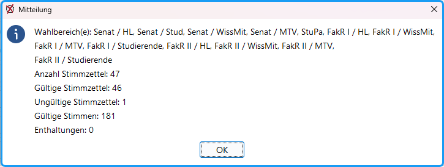
