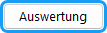

1. Wählen Sie den Wahlbereich, für den Sie die Auszählung der Stimmzettel vornehmen wollen.
1. Öffnen Sie im Wahlbereichsfenster die Karteikarte `Zählen und Auswerten` .
1. Für jede Stimme klicken Sie auf das Namensfeld des oder der jeweiligen Kandidat:in. Dabei erhöhen sich die Zähler für die Stimmenzahl der Personen, die Zahl der abgegebenen Stimmen und bei Listenwahl die Zahl der Stimmen der jeweiligen Liste.
1. Sie können auch direkt in das Zählerfeld einer oder eines Kandidat:in Zahlen eingeben.
1. Ungültige und gültige Stimmzettel werden mit den entsprechenden Zählern gezählt. (Wenn jede:r Wähler:in nur 1 Stimme hat, entfällt der Zähler für gültige Stimmzettel.)
1. Kontrollieren Sie die Anzahl der Wahlberechtigten und korrigieren Sie diese eventuell.

|  |  |
|---|---|
|  | Die letzten Eingaben können rückgängig gemacht werden. |
|  | Rückgängig gemachte Änderungen werden wiederhergestellt. |
|  | Hiermit kann man Kandidat:innen eine (größere) Zahl von Stimmen hinzufügen. |

|  |  |
|---|---|
|  | Wenn die Auszählung fertig ist, betätigen Sie diese Taste. Erst danach kann die Sitzzuteilung erfolgen. |
|  | Starten Sie die Auswertung für den aktuellen Wahlbereich. Die Anzahl der Sitze jeder Liste wird angezeigt und die gewählten Kandidat:innen erscheinen farbig unterlegt. |
