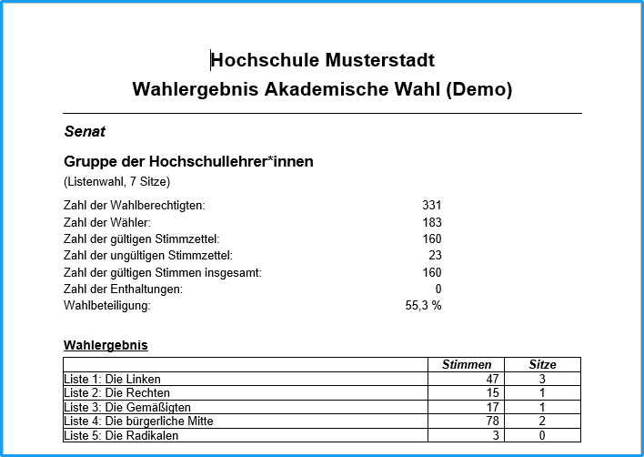

Wenn Sie wissen wollen, wie das Ergebnis der Auswertung zu Stande gekommen ist, rufen Sie mit der Taste `Protokoll` im Zählfenster oder im Menü `Funktionen / Auswerteprotokoll` auf.

## Wahlergebnis ausgeben {#wahlergebnis-ausgeben}

Wenn für alle Wahlbereiche diese Eingaben erfolgt sind, kann die Bekanntmachung des Wahlergebnisses herausgegeben werden. Im Menü `Ausgabe` rufen Sie `Wahlergebnis` auf.

